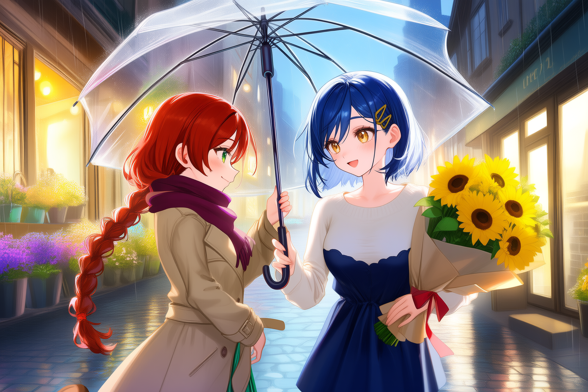
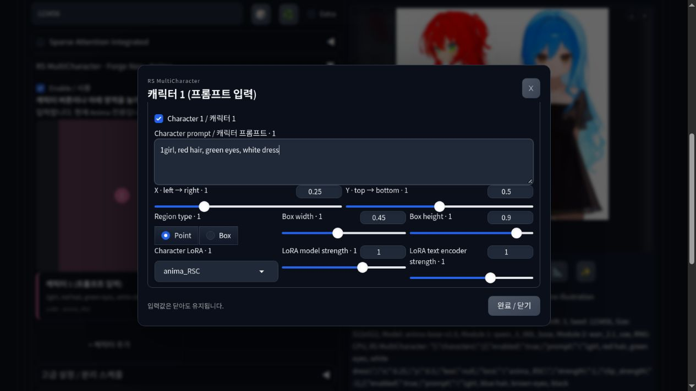

# RS MultiCharacter for Forge Neo

[English](README.md) · [기능 비교](docs/feature-parity.md) · [검증 기록](docs/validation.md)

**Forge Neo에서 캐릭터별 프롬프트·위치·LoRA를 나눠 적용하는 Anima용 확장**입니다. [ComfyUI 원본](https://github.com/raspie10032/ComfyUI_RS_MultiCharacter_Sampler)의 파이프·영역 attention·3D 편집기를 재사용합니다.

**현재 `0.1.0a5` 알파이며, 앱 모드 외에도 아직 옮기지 않은 기능이 있습니다.** Anima 2B / Forge Neo `neo-2.31`, 커밋 `4f4284b02a5c814b81c328c64ed7e99a139f21ef`에서 시험했습니다. 다른 Forge 버전과 모델 계열은 검증하지 않았습니다.



예제: 1728×1152, Euler a / SGM Uniform, 24스텝, CFG 4, Precision, 서로 다른 스타일 LoRA 두 개. 장면용 스케줄은 `0.5 / 1.0 / 0.2`이며 확장 기본값은 원본 스케줄입니다. PNG 생성 설정을 유지했고 모델·LoRA 파일은 배포하지 않습니다.

## 설치와 사용

Forge Neo의 **Extensions → Install from URL**에 다음 주소를 넣고 설치한 뒤 WebUI를 재시작하세요.

```text
https://github.com/raspie10032/sd-forge-rs-multicharacter
```

또는 Forge Neo 폴더에서 실행합니다.

```bash
git clone https://github.com/raspie10032/sd-forge-rs-multicharacter.git extensions/sd-forge-rs-multicharacter
```

[릴리스 ZIP](https://github.com/raspie10032/sd-forge-rs-multicharacter/releases)은 `extensions/sd-forge-rs-multicharacter/scripts/` 구조가 되도록 풀고 재시작합니다. 별도 런타임 패키지 설치는 필요 없으며 모델·인코더·VAE·LoRA를 자동 다운로드하지 않습니다.

1. Anima 체크포인트와 맞는 인코더·VAE를 선택합니다.
2. txt2img 또는 img2img의 **RS MultiCharacter · Forge Neo · Anima**에서 **멀티캐릭터 사용**을 켭니다.
3. Forge 기본 Positive에 공통 장면·배경, Negative에 공통 네거티브를 씁니다.
4. **캐릭터 1 (프롬프트 입력)** 버튼이나 미리보기 영역을 누릅니다. 플로팅 창에서 프롬프트·위치·LoRA·강도를 설정하고 닫으면 값이 유지됩니다. **+ 캐릭터 추가**로 최대 10슬롯을 입력합니다.
5. 우선 **Precision / Euler a / SGM Uniform**으로 시작해 Generate를 누릅니다. txt2img·img2img·Hires.fix 실행을 시험했습니다.

LoRA는 드롭다운으로 선택하세요. 캐릭터 문장 안의 `<lora:...>`는 지원하지 않습니다. 모델·텍스트 인코더 강도를 따로 지정할 수 있습니다. Point는 위치를 중심으로 화면을 나누고 Box는 적용 사각형을 지정합니다. 미리보기는 출력 비율을 따릅니다.



## 옮겨온 기능과 남은 기능

**포팅됨:** 공통·캐릭터별 프롬프트, 최대 10슬롯, XY/Box 영역, 캐릭터별 일반 선형 LoRA와 강도, Normal/Precision, 분리 스케줄, 3D 편집기·실루엣 마스크, 포즈 라이브러리와 JSON/BVH/ZIP 가져오기, JSON 프리셋, PNG 설정 복원.

**미포팅:** 앱 모드, 캐릭터별 네거티브, 직접 그리기·외부 마스크, 신체 부위별 프롬프트 마스크·강조, 전용 상호작용·카메라 조건, 캐릭터 이미지 참조, 학습된 포즈 어댑터, 이미지→3D 추정, 디테일러·태거, 점진적 해상도 샘플러, 글자 영역, RS NAI 파이프 호환, SDXL/FLUX 등 다른 모델. DoRA·LoHa·LoKr 등 확장 어댑터와 양자화/GGUF의 원본 동등 지원도 이번 범위 밖입니다.

3D 카메라는 **마스크 투영**을 바꾸며 원본의 전용 카메라 조건과 구분됩니다. 실루엣은 영역 유도이고 정확한 자세를 강제하지 않습니다. 포즈 라이브러리는 Forge의 `models/rs_pose3d/`에 저장합니다. [상세 기능표](docs/feature-parity.md).

10슬롯은 입력 개수이지 정확한 인원수 보장이 아닙니다. 2/3/4인 대조에서 양쪽 모두 인원이 늘면 외형·역할 혼합과 인물 누락이 생겼습니다. 손·공유 소품·상호작용도 불완전할 수 있습니다.

다른 attention 교체 확장과의 동시 사용은 지원하지 않습니다. Anima 이미지 참조와 Nunchaku는 명시적으로 차단합니다. ControlNet·다른 확장 조합은 검증하지 않았습니다.

## 모드·스케줄·이미지 설정 복원

**Normal**은 계산을 공유하며 레이어 안에서 영역별 LoRA delta를 적용합니다. **Precision**은 서로 다른 LoRA 설정별 모델 예측을 계산한 뒤 영역별로 합칩니다. 두 모드의 결과는 달라질 수 있습니다. Normal 미지원 레이어는 Precision으로 전환하고 이유를 로그와 PNG에 남깁니다. 미지원 어댑터 형식은 일부만 적용하지 않고 오류를 냅니다.

기본 스케줄: 공통 비중 `0.05`, 캐릭터 강조 `1.7`, 초기 분리 `0.9`, 유지 `3`, 감쇠 `0.2`. **ComfyUI 기본 스케줄 적용**은 이 다섯 값만 복구합니다. 불러온 PNG·프리셋 값이 우선입니다. 배경·상호작용은 장면별 조절이 필요합니다.

- **PNG Info**에 원본 PNG를 넣고 **Send to txt2img / img2img**를 누릅니다.
- 원본 PNG를 **Positive에 드래그**하면 생성 정보가 들어옵니다. 이어 Forge의 **생성 설정 복원 버튼**을 눌러야 설정이 적용됩니다.
- 패널에서 JSON 프리셋도 내보내고 불러올 수 있습니다.

Forge 기본 `parameters` 안의 `RS MultiCharacter` JSON에 캐릭터·영역·LoRA·스케줄·모드·3D 장면을 저장합니다. ComfyUI workflow는 넣지 않습니다. 모델·LoRA는 로컬에 있어야 하고 메타데이터가 지워진 이미지·스크린샷은 복원할 수 없습니다.

## 검증과 라이선스

자동 검사 29개, 실제 Forge 백엔드, WebUI 생성·복원·3D 적용을 시험했습니다. 동일 인코딩 텍스트·노이즈·sigma·가중치에서 작은 모델 36조건 및 실제 Anima 첫 단계 두 모드가 원본과 최대 오차 0이었습니다. **독립 생성한 최종 PNG의 픽셀 일치를 의미하지 않습니다.** [검증 범위와 2/3/4인 대조](docs/validation.md).

[개발 안내](docs/development.md) · [GPL-3.0-only](COPYING) · [외부 자산 라이선스](THIRD_PARTY_NOTICES.md). 모델 가중치는 포함하지 않습니다.
