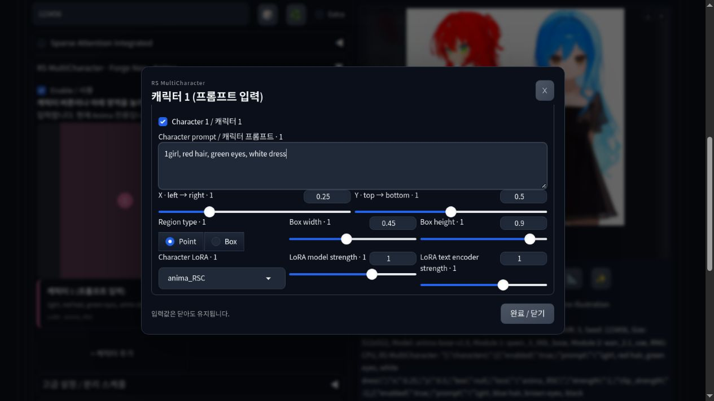

# RS MultiCharacter for Forge Neo

[한국어](README.ko.md) · [Feature comparison](docs/feature-parity.md) · [Validation](docs/validation.md)

Separate character prompts, regions and LoRAs in **Forge Neo's Anima image generation**. Reuses the character pipeline, attention routing and 3D editor from [ComfyUI RS MultiCharacter Sampler](https://github.com/raspie10032/ComfyUI_RS_MultiCharacter_Sampler).

**0.1.0a5 — alpha. This ports the Anima multi-character path, with a subset of the original tools. It does not include every ComfyUI feature.** Tested on Anima 2B / Forge Neo `neo-2.31`, commit [`4f4284b`](https://github.com/Haoming02/sd-webui-forge-classic/commit/4f4284b02a5c814b81c328c64ed7e99a139f21ef). Other builds and model families are not validated.


1728×1152, Euler a / SGM Uniform, 24 steps, CFG 4, Precision, two different style LoRAs. Scene-specific schedule: `0.5 / 1.0 / 0.2`; extension defaults remain the original schedule. PNG settings are retained. Checkpoint and LoRA weights are not included.

## Install

In Forge Neo, open **Extensions → Install from URL**, enter the following URL, install, then restart the WebUI:

```text
https://github.com/raspie10032/sd-forge-rs-multicharacter
```

Or run from your Forge Neo directory:

```bash
git clone https://github.com/raspie10032/sd-forge-rs-multicharacter.git extensions/sd-forge-rs-multicharacter
```

Alternatively, extract a [release ZIP](https://github.com/raspie10032/sd-forge-rs-multicharacter/releases) so that `scripts/` is directly inside `extensions/sd-forge-rs-multicharacter/`. Restart after installing or updating. The extension uses Forge's existing dependencies and does not download models or adapters.

## Generate

1. Load an Anima checkpoint and its text encoder / VAE.
2. Open **RS MultiCharacter · Forge Neo · Anima** in txt2img or img2img and enable the extension.
3. Write the shared scene/background in Forge's normal positive prompt and shared negatives in its negative prompt.
4. Click **캐릭터 1 (프롬프트 입력)** / **Character 1**, or its region in the canvas. Enter the character prompt, position, optional LoRA and strengths in the floating editor. Closing it preserves values. **+ 캐릭터 추가** adds slots, up to 10.
5. Start with **Precision / Euler a / SGM Uniform**, the original Anima example combination, and use Forge's normal Generate button.

Select character LoRAs in their dropdowns. Inline `<lora:...>` tags inside character prompts are unsupported. Point regions partition the canvas around positions; Box regions define explicit rectangles. The preview follows the output aspect ratio. txt2img, img2img and Hires.fix were tested.



The **3D editor** supports joint/finger editing, JSON/BVH/ZIP pose import, local presets and numbered silhouette masks. Its camera controls mask projection. **Silhouettes guide composition; they do not provide learned joint conditioning or guarantee poses.** Image → 3D estimation is unavailable. Pose library location: Forge's `models/rs_pose3d/`.

## Included features and limits

| Feature | Forge status |
| --- | --- |
| Common scene + up to 10 numbered character prompts | Included |
| Point / Box positioning, regional attention and separation schedule | Included |
| Per-character plain linear LoRA, separate model/text encoder strengths | Included |
| Normal and Precision modes | Included; unsupported Normal layers fall back with a recorded reason |
| 3D editor, silhouette regions, pose library, JSON/BVH/ZIP pose import | Included; silhouette guidance only |
| txt2img, img2img, Hires.fix | Tested |
| JSON presets and PNG setting restoration | Included |
| App Mode | Not included |
| Painted / external masks, dedicated interaction / camera conditioning | Not ported |
| Character image reference, learned pose adapter, image → 3D estimation | Not ported |
| Detailer, tagger, progressive-resolution sampler, text regions, RS NAI pipes | Not ported |
| SDXL, FLUX and other non-Anima paths | Not ported |
| Extended adapters such as DoRA/LoHa/LoKr; GGUF / quantized parity | Outside this release's support scope |

See the [full comparison](docs/feature-parity.md). Ten slots are input capacity, not guaranteed character count. Both Forge and ComfyUI lost people, identities or action assignments in our paired 2/3/4-person tests. Hands, shared objects and precise interactions can still be wrong.

Other attention-replacing extensions, including Forge Couple, are unsupported. Anima image reference and Nunchaku are explicitly rejected. ControlNet and other extension combinations are not validated.

**Normal** shares model computation and applies regional LoRA deltas inside supported layers. **Precision** evaluates each distinct model-LoRA setting separately, then blends predictions with the original masks. Outputs may differ. Unsupported adapter formats fail instead of silently applying a partial adapter.

Default schedule: common prior `0.05`, character gain `1.7`, initial separation `0.9`, hold `3`, decay `0.2`. **ComfyUI 기본 스케줄 적용** restores only these five values. Imported PNGs/presets keep stored values. Background-heavy scenes may need different settings; no universal quality preset is promised.

## Restore image settings

- **PNG Info:** load an original PNG and use **Send to txt2img / img2img**.
- **Prompt drag and drop:** drop the original PNG onto the positive prompt, then click Forge's **restore generation parameters** button. Dropping alone fills infotext and does not apply all settings.
- **JSON:** use the panel's preset export/import controls.

Forge's normal `parameters` metadata stores the base settings. Its `RS MultiCharacter` JSON field stores character prompts, regions, LoRAs, schedule, mode and optional 3D scene, with separate version/effective-mode fields. No ComfyUI workflow is embedded. Required models/LoRAs must exist locally; screenshots and metadata-stripped images cannot restore settings.

## Verification and license

29 automated tests and a native Forge-backend smoke test passed. With identical encoded text, latent, sigma and weights, the model/region/LoRA path matched the original with maximum absolute error 0 in 36 small-model conditions and a captured Anima 2B first call in both modes. **This does not establish independently generated final-image equality.** [Validation details, WebUI checks and paired examples](docs/validation.md).

[Development](docs/development.md) · [GPL-3.0-only](COPYING) · [Third-party notices](THIRD_PARTY_NOTICES.md). Three.js is MIT; MHR assets are Apache-2.0. Model weights are not distributed.
