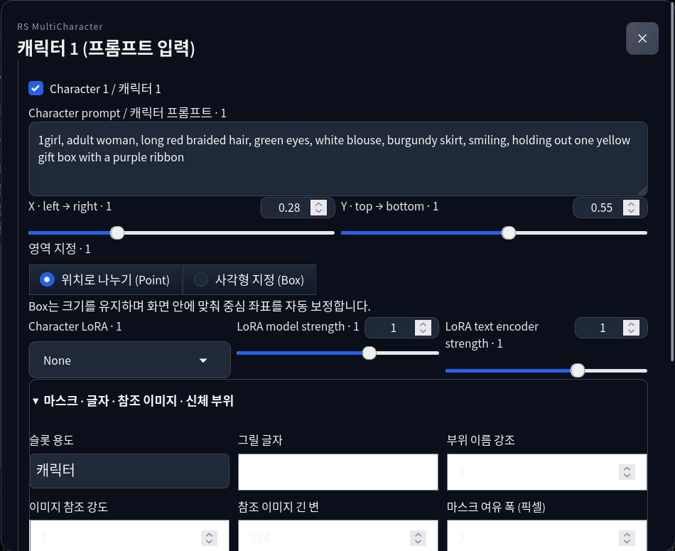

# RS MultiCharacter for Forge Neo — ユーザーガイド

[한국어](user-guide.ko.md) · [English](user-guide.md) · **日本語** · [简体中文](user-guide.zh-CN.md)

**0.2.0a1（アルファ版）対応**。配布版の画面に沿って説明します。拡張機能の UI は現在、主に韓国語または韓国語・英語の併記です。操作箇所を探せるように実際の表示名も記載しています。このガイドの翻訳は UI の言語変更を意味しません。

## 目次

1. [インストールと更新](#install)
2. [最初の2人画像を生成する](#quick-start)
3. [プロンプトと領域の割り当て](#prompts-regions)
4. [キャラクター別 LoRA](#loras)
5. [Normal・Precision と分離スケジュール](#schedules)
6. [マスク・身体部位・文字領域](#masks-text)
7. [3D 編集とポーズライブラリ](#pose3d)
8. [参照画像と学習済みポーズ誘導](#references)
9. [相互作用・カメラ・レイアウト](#camera-layout)
10. [段階的な解像度変更](#progressive)
11. [ディテイラー・タガー・フォルダー一括補正](#detailers)
12. [PNG・ドラッグ＆ドロップ・JSON の復元](#restore)
13. [追加の依存パッケージとモデル](#models)
14. [トラブルシューティング](#troubleshooting)
15. [対応範囲](#scope)

<a id="install"></a>
## 1. インストールと更新

**Forge Neo** 用の拡張機能です。検証済みホストは Linux/Python 3.12 上の neo-2.31、コミット `4f4284b02a5c814b81c328c64ed7e99a139f21ef` です。他のホストリビジョンは未検証です。Windows BAT の導入処理は別途検査しており、Windows での実生成検証を意味しません。

### インストール前の準備

Forge Neo がない場合は、先に [Forge Neo 公式のインストール手順](https://github.com/Haoming02/sd-webui-forge-classic/tree/neo#installation)に従って導入します。チェックポイントと対応するエンコーダー・VAE を準備し、拡張機能を入れる前に Forge 単体で通常の画像を生成できることを確認します。必要なファイルは [Forge 公式モデル案内](https://github.com/Haoming02/sd-webui-forge-classic/wiki/Download-Models)を参照してください。

下の **Windows BAT・URL・Git・ZIP のいずれか1つ**で導入します。Forge フォルダーは `launch.py` と `extensions/` がある場所です。ComfyUI の `custom_nodes/` には入れません。

<a id="windows-bat"></a>
### Windows 推奨：BAT 1個でインストール・更新

1. **Forge Neo と起動用ターミナルを完全に終了**します。ブラウザーのタブを閉じるだけでは Forge は動いたままです。
2. **[Install-RS-MultiCharacter.bat をダウンロード](https://github.com/raspie10032/sd-forge-rs-multicharacter/releases/download/v0.2.0a2/Install-RS-MultiCharacter.bat)**します。通常、Git や管理者権限は不要です。
3. BAT をダブルクリックし、Forge のパスを貼り付けるか、**Enter** でフォルダー選択画面を開きます。
4. **`launch.py` がある Forge Neo フォルダー**を選びます。ポータブル版の親フォルダーを選ぶと、内部の `webui` を探します。モデルフォルダーや ComfyUI は選ばないでください。
5. 最新の公開リリース（**アルファ版を含む**）を取得し、SHA-256 を確認して導入します。**Installed** が表示されたら、普段のランチャーで Forge を起動し、ブラウザーで **Ctrl+Shift+R** を押します。BAT は Forge を自動起動しません。

動作中の Forge/WebUI が見つかると、終了を案内して処理を中止します。プロセスは強制終了しません。取得・チェックサム・ZIP の検証は既存拡張の交換前に行い、交換に失敗した場合は元のフォルダーに戻します。

旧拡張は丸ごと **`<Forge>/.rs-mc-backups/sd-forge-rs-multicharacter-日付-ID/`** に保存します。Forge 設定、モデル、ポーズライブラリ、参照ファイル、他の拡張は保持します。拡張内の手動変更はバックアップに残ります。元に戻すには Forge を終了し、現在の拡張フォルダーを別の場所へ移してから、バックアップを `extensions/sd-forge-rs-multicharacter` に移します。

**更新時も Forge を終了して同じ BAT を実行**します。BAT はリリース ZIP 方式です。URL/Git 版を置き換えた場合、`.git` もバックアップに移るため、以後は BAT で更新してください。Git 管理を続ける場合は下の URL/Git 方式を使います。

BAT が導入するのは**この拡張のみ**です。Forge Neo 本体、チェックポイント、追加機能の依存パッケージ・重みは導入せず、GPU 選択、起動オプション、ブラウザー自動起動設定も変更しません。追加機能は[13節](#models)を参照してください。Linux では下の URL/Git/ZIP 方式を使います。

### 方法 A：WebUI で URL からインストール

1. Forge Neo で **Extensions → Install from URL** を開きます。
2. **URL for extension's git repository** に下の URL を貼り付けます。
3. **Specific branch name** と **Local directory name** は空欄のまま、**Install** を押します。
4. 完了後、**Extensions → Installed** で `sd-forge-rs-multicharacter` が有効になっていることを確認します。
5. **Apply and restart UI** を押します。**Apply and quit** と表示される場合は、終了後に普段のランチャーで Forge を起動し直します。ブラウザーも再読み込みします。

```text
https://github.com/raspie10032/sd-forge-rs-multicharacter
```

### 方法 B：Git でインストール

Git が使える環境で Forge を終了し、**Forge フォルダー内で**次を実行してから、通常どおり起動します。URL 方式と同じ Git 管理のインストールになります。

```bash
git clone https://github.com/raspie10032/sd-forge-rs-multicharacter.git extensions/sd-forge-rs-multicharacter
```

### 方法 C：ZIP でインストール

1. Forge を終了し、[Releases](https://github.com/raspie10032/sd-forge-rs-multicharacter/releases) から必要なバージョンの拡張 ZIP を取得します。
2. Forge の `extensions/` に展開し、拡張フォルダー名を `sd-forge-rs-multicharacter` にします。
3. 下のファイルを確認してから Forge を起動します。拡張フォルダーを二重にしないでください。

```text
<Forge フォルダー>/extensions/sd-forge-rs-multicharacter/scripts/rs_multicharacter.py
```

`scripts/` と同じ階層に `rs_forge_mc/`、`javascript/` も必要です。

### 導入確認と更新

txt2img または img2img の **RS MultiCharacter · Forge Neo** を開き、**멀티캐릭터 사용** をオンにして **캐릭터 1 (프롬프트 입력)** を押します。フローティング入力画面が開けば UI は読み込まれています。[2節の2人例](#quick-start)で実際の生成も確認してください。

URL・Git 方式の更新は **Extensions → Installed → Check for updates** で対象の拡張機能を選び、適用・再起動します。ZIP 方式は Git 更新に対応しないため、Forge を終了して新しい ZIP の拡張フォルダーに置き換えます。更新前に JSON プリセットと手動で変更したファイルを別途保存してください。古い UI が残る場合は **Ctrl+Shift+R** で強制再読み込みします。

パネルが出ない場合は、フォルダーの二重化、Installed の有効状態、Forge の起動ターミナルに出る拡張読み込みエラーを確認します。参照・ディテイラーで依存関係の不足が表示されたら、[13節](#models)の該当パッケージだけを **Forge が使う Python** で導入し、再起動します。

基本生成に追加パッケージは不要です。追加機能の重みは、その機能を実行するときに準備します。起動だけではダウンロードしません。チェックポイント、エンコーダー、VAE、LoRA の重みは同梱していません。

<a id="quick-start"></a>
## 2. 最初の2人画像を生成する

対応するエンコーダー・VAE と **Anima 2B** チェックポイントを準備し、**txt2img** で始めます。

1. **幅 1728、高さ 1152、Euler a、SGM Uniform、24 ステップ、CFG 4**、固定シード `823401` にします。最初はバッチサイズ・回数を 1 にし、Hires.fix と追加機能はオフにします。
2. **RS MultiCharacter · Forge Neo → 멀티캐릭터 사용**（複数キャラクターを有効化）をオンにします。オフでもカードは編集できますが、生成には適用されません。
3. Forge の通常の Positive に共通シーン、Negative に共通ネガティブを入力します。
4. **캐릭터 1 (프롬프트 입력)**（キャラクター1・プロンプト入力）を開き、プロンプトと **Point、X 0.28、Y 0.55** を設定します。LoRA は **None** にします。
5. **완료 / 닫기** で閉じ、キャラクター2を開きます。必要なら **+ 캐릭터 추가** で追加します。2人目は **Point、X 0.72、Y 0.55** にして、両方のチェックボックスをオンにします。
6. **precision** を選び、分離スケジュールは元の既定値のまま **Generate** を押します。

以下はコピーして試せる開始例です。特定の画像を保証するものではありません。

| 入力欄 | プロンプト |
| --- | --- |
| Forge Positive | `2girls, two adult women, sharing one umbrella, standing outside a flower shop, rainy street, buckets of flowers, warm shop window light, full scene, anime illustration` |
| Forge Negative | `low quality, blurry, extra people, duplicate person, extra arms, extra fingers, watermark` |
| キャラクター1 | `1girl, adult woman, long red braided hair, green eyes, white blouse, burgundy skirt, standing on the left, holding the umbrella handle` |
| キャラクター2 | `1girl, adult woman, short blue bob hair, golden eyes, navy dress, cream cardigan, standing on the right, holding a bouquet with both hands` |

公開例のシーン向け設定と比較する場合は、**Initial common prior `0.5`、Early character V gain `1.0`、Initial spatial separation `0.2`** の3項目だけを変更します。保持は `3`、減衰は `0.2` のままです。配布時の既定値や、あらゆるシーンに有効な品質設定ではありません。


<a id="prompts-regions"></a>
## 3. プロンプトと領域の割り当て

**共通プロンプト**には背景、照明、構図、総人数、共同行動や小道具を記述します。**キャラクタープロンプト**には各人の髪、目、服装、役割を記述します。物の受け渡しなら、共通欄に共有する物を1つ書き、それぞれに渡す・受け取る役割を割り当てます。全員のシーンを各キャラクター欄で繰り返すと、割り当てが難しくなることがあります。

ネガティブは Forge 共通の Negative を使います。キャラクター別ネガティブは実装対象から外しています。スロットが参加するには、**チェックがオンで、プロンプトが空でないこと**が必要です。最大10スロットは入力上限であり、10人の生成を保証しません。txt2img と img2img の拡張設定は別々です。

| 領域設定 | 意味 |
| --- | --- |
| **位置で分割 / 위치로 나누기 (Point)** | 各キャラクター座標への近さで画面を分割します。単純な左右配置の出発点に使えます。 |
| **矩形指定 / 사각형 지정 (Box)** | 中心 X/Y と幅・高さで矩形を指定します。重なる部分では両方の条件が混ざる場合があります。 |
| **X, Y** | 正規化座標です。X は左 `0`→右 `1`、Y は上 `0`→下 `1`。 |
| **Box width / height** | 画像全体に対する比率。幅 `0.4` は画像幅の40%です。Box で使います。 |

端に移動した Box はサイズを保ち、中心がキャンバス内に補正されます。プレビューは Forge の出力比率に従います。色付き領域やカードを押すと入力ウィンドウが開き、閉じても値は保持されます。輪郭を指定したい場合はマスクや3Dシーンを使います。

<a id="loras"></a>
## 4. キャラクター別 LoRA

**Character LoRA** で Forge に登録されたファイルを選びます。追加したファイルが見えない場合は **Refresh LoRA list / LoRA 목록 새로고침** を押します。モデル系列に合った LoRA を使ってください。

- **LoRA model strength:** 拡散モデルへの強度。
- **LoRA text encoder strength:** 対応テンソルが含まれる場合のテキストエンコーダーへの強度。
- **None:** キャラクター専用 LoRA を使いません。最初の例は LoRA なしで実行できます。

キャラクタープロンプト内の `<lora:...>`、`<lyco:...>`、`<hypernet:...>` は拒否されます。選択欄と強度設定を使ってください。Forge 全体に適用した LoRA はキャラクター別の指定にはなりません。

DoRA、LoHa、LoKr、GLoRA、OFT、IA³ などの拡張形式は Forge ローダーと対象レイヤーに依存します。Normal の共有実行に対応しない場合は Precision に切り替わり、不一致の重みはエラーになります。すべての学習済みアダプターの組み合わせを検証したわけではありません。

<a id="schedules"></a>
## 5. Normal・Precision と分離スケジュール

**precision** はキャラクター LoRA 設定ごとに予測し、領域別に合成します。分離の確認を始めるモードに適していますが、異なる LoRA が増えると遅くなる場合があります。**normal** は対応レイヤーの計算を共有し、速くなる場合があります。特徴の混ざり方も異なり、同じ画像になるとは限りません。

**고급 설정 / 분리 스케줄**（高度な設定・分離スケジュール）を開きます。

| 実際の表示名 | 既定値 | 役割 |
| --- | --- | --- |
| Initial common prior | `0.05` | 初期ルーティングの共通プロンプト比重。 |
| Early character V gain | `1.7` | 初期のキャラクター値の強調。 |
| Initial spatial separation | `0.9` | 初期のキャラクター間の空間分離。 |
| Boundary hold steps | `3` | 初期境界を保持するステップ数。 |
| Boundary decay per step | `0.2` | 保持区間後、各ステップで境界を緩める量。 |

**ComfyUI 기본 스케줄 적용** はこの5項目だけを既定値に戻します。プロンプト、LoRA、マスクや拡張全体はリセットしません。PNG・プリセットの読み込みでは保存値が優先されます。

強い分離は背景や共同動作と競合する場合があります。シードを固定し、1項目ずつ比較してください。**추가 기능** の後半共通プロンプト増加量と領域境界のぼかしは別の設定です。

<a id="masks-text"></a>
## 6. マスク・身体部位・文字領域

キャラクター入力内の **마스크 · 글자 · 참조 이미지 · 신체 부위**（マスク・文字・参照画像・身体部位）を開きます。



**マスク:** **마스크 그리기 / 가져오기** を押します。キャラクターの領域を白、それ以外を黒にします。ブラシ・**지우개**（消しゴム）で編集するか白黒画像を取り込み、**이 마스크 적용** で適用します。**취소** はそのダイアログの変更を破棄します。空のマスクは使えません。**마스크 해제** でカスタムマスクを外します。マスクはスロットの通常領域に代わって使われます。3Dも使用していた場合、完全に Point/Box に戻すには3Dシーンも解除してください。

**마스크 여유 폭 (픽셀)** は元マスクのピクセル単位で領域を広げます。移動量はキャンバス比率、拡大縮小はキャンバス中心が基準です。外側は切り取られます。出力解像度の設定ではありません。

**부위 이름 강조**（部位名の強調）には、3Dシーンまたは共通追加設定の **OpenPose JSON / 뼈대 PNG** による部位データが必要です。`0` から始め、ポーズを用意してから上げます。部位名の強調と学習済みポーズアダプターは別機能です。高度なプリセットから明示的な部位マスクを渡すこともできます。

**文字:** **슬롯 용도 → 글자 영역 (Box 필요)**（文字領域・Box必須）に変更し、Box と **그릴 글자**（描く文字）を指定します。スロットのプロンプトにも看板や文字領域の説明を入力し、空にしないでください。文字スロットはキャラクター LoRA を使いません。正確に綴れるかはモデルに依存します。

<a id="pose3d"></a>
## 7. 3D 編集とポーズライブラリ

1. 先に Forge の最終幅・高さを設定します。
2. **3D Pose / 기존 3D 포즈 편집기 → 3D 편집기 열기 / Open 3D editor** を開きます。
3. 番号ごとの人物、関節、指を編集し、望む輪郭になるようビューを調整します。人物番号をキャラクタースロットに合わせます。
4. ライブラリ・読み込みから、保存済みポーズや対応する JSON、OpenPose/DWPose/Yu Zhu、BVH、ZIP を使用します。
5. 固定フッターの **캐릭터 영역에 적용 / Apply to character regions** を押します。閉じるだけでは適用されません。

ライブラリは Forge の `models/rs_pose3d/` に保存されます。キャンバスは Forge の縦横比に従います。**3D 영역 해제 · 위치/박스로 전환** は3Dシーンを解除します。描画したカスタムマスクはスロット側で別途解除します。

既定の **실루엣 영역만** はシルエットを領域として使い、関節姿勢の正確な再現を保証しません。学習済みポーズは次の節で有効にします。エディターの周回カメラは投影を変え、専用カメラ条件パネルとは別です。

**画像→3D:** エディターの **이미지→3D** に、1人が明瞭に写った切り抜きを入れます。初回に約 **2.83 GB** の SAM 3D Body 重みをダウンロードする場合があります。推定された関節を確認・修正して適用します。隠れた手足や奥行きは誤る場合があります。

<a id="references"></a>
## 8. 参照画像と学習済みポーズ誘導

キャラクターの **참조 이미지 넣기** でアップロードし、**이미지 참조 강도**（参照強度）と **참조 이미지 긴 변**（長辺、初期値 `384`）を設定します。**참조 해제** で解除します。共通の **추가 기능 → 이미지 참조 방식** で方式を選びます。

| Anima の方式 | 制限 |
| --- | --- |
| Reference frame | 2B/2.9B の構造に合うアダプターが必要。2.9B は専用重みを使用します。 |
| Asymmetric v2 | 実験的、Anima 2B 専用。キャラクター LoRA との併用は元実装で未検証のためブロックします。 |
| Role K/V | Anima 2B BF16/FP32。相互作用は baseline、部位強調は `0`。キャラクター LoRA 併用時は **normal** が必要です。 |
| SigLIP IP-Adapter | 旧方式。対応するエンコーダー・アダプターの依存関係が必要です。 |

Guidance、アダプター強度、参照倍率、補正、キャッシュは方式別の設定です。最初は変更せず使ってください。SD IP-Adapter と FLUX/Krea/MOSS の参照経路もありますが、このリリースでは該当する学習済みチェックポイントでの生成は未検証です。

**学習済みポーズ:** 3Dシーンを適用し、**3D 학습된 자세 유도 → 자세 적용 → 학습된 모델별 자세 어댑터**（`auto`）を選びます。強度と開始・終了比率を設定し、終了を開始より後にします。元実装の対応系列は Anima、Krea 2、MOSS で、それぞれ対応重みが必要です。Anima アダプターは対応する2B構造を必要とします。

**画像参照と学習済みポーズは同時に使えません。** 学習済みポーズは全解像度が必要なので、段階的解像度の開始倍率は `1` にします。シルエットを適用するだけでは学習済みポーズは有効になりません。

参照画像はローカルの `models/rs_mc/assets/` に保存され、PNG・プリセットには画像自体ではなく資産 ID が入ります。アップロードは最大2,400万画素の単一画像で、保存時に RGB・長辺最大2048に整えられます。元ファイルは別途保管し、別環境では参照を再アップロードしてください。

<a id="camera-layout"></a>
## 9. 相互作用・カメラ・レイアウト

**추가 기능 / 마스크·카메라·참조·디테일러**（追加機能）を開きます。

- **상호작용 · 겹침 제어:** baseline、3/6ステップ追加保持、またはカスタム境界設定です。重なりのスケジュールを変えます。動作はプロンプトで指示し、手の接触や共有小物が自動で解決するわけではありません。
- **카메라 조건:** 有効化して水平角、垂直角、距離、ロール、強度を設定します。共通のみ／共通＋キャラクターの範囲を選べます。**영역 좌표 동기화** は固定、距離・回転、透視投影から選びます。
- **프롬프트 문법:** 既定または NovelAI の重み構文です。重みの解釈であり NovelAI サービスの呼び出しではありません。
- **레이아웃 방식:** 通常は領域別計算を使用します。**MOSS 기본 레이아웃 JSON** は MOSS 専用で、参加する全スロットに Box またはマスク、既定の ComfyUI 構文、参照画像なし、キャラクターのテキストエンコーダー LoRA 強度 `0` が必要です。他モデルでは説明付きで停止します。自動選択はモデルに応じた経路を選びます。

<a id="progressive"></a>
## 10. 段階的な解像度変更

Forge の幅・高さは最終サイズにします。**점진 해상도 · 시작 배율 (1 = 끄기)** の `1` はオフ、`0.5以上1未満` は小さな latent から始め、1つの sigma スケジュールを3段階に分けて拡大します。

**txt2img で Hires.fix をオフ**にして使用します。マスク付きインペイントは固定解像度が必要です。全解像度を必要とする学習済みポーズもオフにします。段階間でソルバー履歴を再開するため、通常の全解像度生成と同じではありません。最終段階は指定サイズに達するので、VRAM 不足の解消は保証できません。

<a id="detailers"></a>
## 11. ディテイラー・タガー・フォルダー一括補正

[追加依存とモデル](#models)を準備し、**추가 기능 → 로컬 디테일러 · 태거** を開きます。

1. **생성 후 디테일러 사용**（生成後ディテイラー）をオンにします。
2. **SEGM 감지 모델** または **BBOX 감지 모델** を選びます。SEGM が優先され、BBOX/SAM をスキップします。BBOX の SAM は任意で、ローカルの ViT-H/L/B 重みが必要です。
3. キャラクター照合タガーを選びます。既存 Forge 環境では WD ViT v3 から始められます。
4. 補正 denoise、クロップサイズ、ステップ、CFG を設定します。初期値は `0.35`、`768`、`20`、`4` です。
5. 生成します。確実に照合できた検出領域を、そのキャラクターのプロンプト・LoRA でマスク img2img 補正し、マスク内に合成します。曖昧な照合はスキップします。閾値を下げると別キャラクターを割り当てる場合があります。

**参照のタグ解析:** 参照をアップロードして **참조 이미지 태그 분석** を押します。選択した WD/PixAI のタグとスコアを確認し、必要なものをプロンプトにコピーします。プロンプトを自動置換しません。この移植版のタガーと YOLO 検出は CPU、拡散生成と画像→3D は Forge が選択した GPU を使います。

**フォルダー補正:** **로컬 폴더 일괄 보정** に、**Forge サーバー側のファイルシステム**の異なる入力・出力パスを入力します。ディテイラーを有効化・設定して **폴더 이미지 보정 시작** を押します。入力画像ごとの生成メタデータではなく、現在のキャラクター、共通 Positive/Negative、モデル、補正設定を使います。

入力直下の PNG/WebP/JPG/JPEG を1～512枚処理し、サブフォルダーは対象外です。結果は `元の名前.ext.rs-detail.png` です。既存結果がある場合は上書きせず停止します。失敗・中断前に完了したファイルは残る場合があるため、再試行時は別の出力フォルダーを使ってください。他の生成とキューを共有します。

<a id="restore"></a>
## 12. PNG・ドラッグ＆ドロップ・JSON の復元

**Forge の元 PNG:** **PNG Info** に生成した元ファイルを入れ、**Send to txt2img / Send to img2img** を押します。生成前に RS パネルと各入力ウィンドウの復元値を確認します。

**ドラッグ＆ドロップ:** 元 PNG を Forge の **Positive プロンプト欄**にドロップし、Forge の**生成設定を復元するボタン**を押します。img2img の画像キャンバスに入れる操作は入力画像の指定です。設定も読み込む場合は復元操作を行ってください。

Forge 標準の `parameters` に共通生成設定と **`RS MultiCharacter` JSON** が保存されます。スロット、プロンプト、LoRA 名・強度、領域、スケジュール、モード、3Dシーン、追加設定を復元します。スクリーンショットやメタデータが消えた画像では復元できません。

**JSON:** **Presets / JSON 프리셋 → Export settings / 설정 내보내기** を押し、表示された JSON をコピーして保存します。貼り付けて **Import settings / 설정 불러오기** を押すと復元します。これは拡張機能の設定です。Forge 共通プロンプト、シード、サンプラー、解像度も一括で戻すには元 PNG を使います。

**ComfyUI/NAI:** **추가 기능 → OpenPose / 원본 PNG·NAI 설정 가져오기 → ComfyUI·NAI PNG / JSON 가져오기** を使います。認識可能な RS キャラクター設定を拡張に取り込むので、Forge の共通生成設定は別途確認します。**NAI 호환 JSON 내보내기** は互換設定ファイルをダウンロードします。ComfyUI グラフの実行、NAI API 呼び出し、重みの復元は行いません。

復元先にも同名のモデル・LoRA ファイルが必要です。参照 ID には対応するローカル資産が必要なので、別 PC では再アップロードします。アプリが違う場合、同じシードでもピクセル一致は保証されません。

<a id="models"></a>
## 13. 追加の依存パッケージとモデル

Forge フォルダーから、**Forge が実際に使用する Python** で実行します。venv や Windows portable では `python` をその実行ファイルに置き換えます。動作中の torch/torchvision は維持し、開発用 `requirements-dev.txt` を Forge に入れないでください。

```bash
# 画像参照の依存不足が報告された場合
python -m pip install -r extensions/sd-forge-rs-multicharacter/requirements-reference.txt

# ディテイラーと WD タガー
python -m pip install -r extensions/sd-forge-rs-multicharacter/requirements-detailer.txt
```

PixAI Tagger v1.0 は **Transformers 5** が必要です。Forge 自体の依存を変更し得るため、互換性を確認した別 Forge 環境でのみ `requirements-pixai-tagger.txt` を使ってください。WD タガーにこの追加更新は不要です。

| Forge `models/` 内のパス | 用途 |
| --- | --- |
| `rs_mc/assets/` | アップロードした参照画像。 |
| `rs_pose3d/` | ポーズライブラリ。 |
| `ultralytics/segm/`, `ultralytics/bbox/` | 検出重み。 |
| `sams/` | 任意のローカル SAM 重み。 |
| `rs_wd_tagger/` | タガーファイル。 |
| `detection/` | 画像→3D モデル。 |

参照・ポーズアダプターはモデル系列別フォルダーを使います。対応する重みがない場合は初回実行時にダウンロードすることがあります。SAM のローカルファイルは用意が必要です。ComfyUI と共有する場合は **Settings → RS MultiCharacter → RS additional model directories** に、サブフォルダー構造を保った **models ルート**を追加して設定を適用します。複数は Linux `:`、Windows `;` で区切ります。補助モデルの検索用であり、キャラクター LoRA は Forge の LoRA 一覧にも必要です。

<a id="troubleshooting"></a>
## 14. トラブルシューティング

| 症状 | 確認点 |
| --- | --- |
| パネルがない・古い UI | ZIP 階層、拡張の有効化、Forge 再起動、ブラウザー強制更新、サーバーの読み込みエラー。 |
| 入力が無視される | 全体・個別チェック、空でないプロンプト、txt2img/img2img のタブ。 |
| 背景が弱い・外見が混ざる | シード固定で共通/個別プロンプト、領域、スケジュールを別々に確認。既定値とシーン向け設定を比較。 |
| 人数・役割が違う | シーンを単純化し領域を確認。ComfyUI/Forge とも多人数で失敗し得ます。 |
| 座標変更が反映されない | カスタムマスクと適用済み3Dシーンを確認・解除。 |
| LoRA がない・重み不一致 | 一覧更新、モデル系列、登録名、不一致エラー。 |
| 参照・ポーズが拒否される | [第8節](#references)の併用・構造・モード制限。 |
| ディテイラーが変えない | 有効化、SEGM/BBOX、検出と照合基準。曖昧な領域は意図的に保存します。 |
| フォルダーが見つからない | サーバー側パス、別出力先、直下に対応画像1～512枚。 |
| PNG 復元失敗 | 元メタデータ、復元操作、拡張の導入、必要な LoRA・参照資産。 |
| メモリ不足・遅い | 解像度、バッチ、追加機能を減らす。複数 LoRA の Precision は重く、段階生成も最後は最終サイズです。 |

報告には拡張/Forge バージョン、モデル系列、モード、サンプラー/スケジューラー、サイズ、ステップ、シード、有効な追加機能、エラー原文、最小再現 PNG/プリセットを添えます。公開前に個人的なプロンプトや参照内容を確認してください。

<a id="scope"></a>
## 15. 対応範囲

実際の学習済みチェックポイントによる生成検証は **Anima 2B 中心**です。他系列の小さなランダム重みモデルの実行検査は、生成品質の検証ではありません。同じエンコード済み入力で主要な Anima 計算を ComfyUI と比較していますが、独立した全工程の PNG ピクセル一致や、すべての追加機能の併用は未検証です。

App Mode と個別ネガティブは対象外です。FLUX3 は検証ホストにエンジンがなく実行不可、Nunchaku はブロックします。量子化/GGUF、他の attention 置換拡張、ControlNet 併用、他 OS は未検証です。マスク・ポーズ・参照は誘導であり、人数、外見、接触、人体、文字の正確さは保証しません。

[機能比較](feature-parity.md) · [検証と制限](validation.md) · [追加の技術設定](advanced.md) · [リポジトリ](../README.ja.md)
