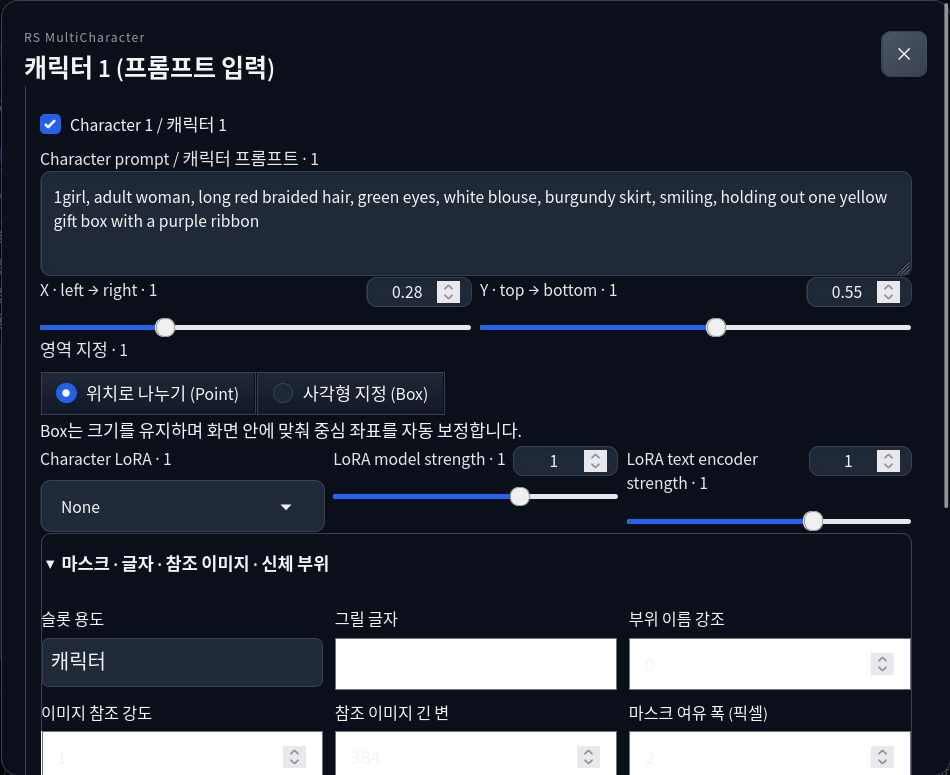

# RS MultiCharacter for Forge Neo — 사용자 가이드

**한국어** · [English](user-guide.md) · [日本語](user-guide.ja.md) · [简体中文](user-guide.zh-CN.md)

**0.2.0a1 알파 기준**입니다. 실제 배포 UI의 버튼 이름으로 설명합니다. 현재 확장 UI는 한국어·영어가 섞여 있으며, 가이드 번역과 UI 언어 변경은 별개입니다.

## 목차

1. [설치와 업데이트](#install)
2. [처음 만드는 2인 이미지](#quick-start)
3. [프롬프트와 영역 배정](#prompts-regions)
4. [캐릭터별 LoRA](#loras)
5. [Normal·Precision과 분리 스케줄](#schedules)
6. [마스크·신체 부위·글자 영역](#masks-text)
7. [3D 편집과 포즈 라이브러리](#pose3d)
8. [이미지 참조와 학습된 자세 유도](#references)
9. [상호작용·카메라·레이아웃](#camera-layout)
10. [점진 해상도](#progressive)
11. [디테일러·태거·폴더 일괄 보정](#detailers)
12. [PNG·드래그앤드롭·JSON 설정 복원](#restore)
13. [선택 의존성과 모델 준비](#models)
14. [문제 해결](#troubleshooting)
15. [지원 범위](#scope)

<a id="install"></a>
## 1. 설치와 업데이트

**Forge Neo**용 확장입니다. 검증한 호스트는 Linux/Python 3.12의 neo-2.31, 커밋 `4f4284b02a5c814b81c328c64ed7e99a139f21ef`입니다. 다른 호스트 버전은 미검증입니다. Windows BAT 설치 절차는 별도로 검사하며, Windows에서의 실제 생성 검증을 뜻하지는 않습니다.

### 설치 전 준비

Forge Neo가 없다면 먼저 [Forge Neo 공식 설치 안내](https://github.com/Haoming02/sd-webui-forge-classic/tree/neo#installation)를 따라 설치합니다. 사용할 체크포인트와 맞는 인코더·VAE를 준비하고 Forge 자체에서 일반 이미지 한 장이 생성되는지 확인합니다. 모델별 파일은 [Forge 공식 모델 안내](https://github.com/Haoming02/sd-webui-forge-classic/wiki/Download-Models)를 참고하세요.

아래 **Windows BAT·URL·Git·ZIP 중 한 가지 방법**으로 설치합니다. Forge 폴더는 `launch.py`와 `extensions/`가 있는 폴더입니다. 이 확장은 ComfyUI의 `custom_nodes/`에 넣지 않습니다.

<a id="windows-bat"></a>
### Windows 권장: BAT 하나로 설치·업데이트

1. **Forge Neo와 실행 터미널을 완전히 종료**합니다. 브라우저 탭만 닫으면 Forge는 계속 실행 중입니다.
2. **[Install-RS-MultiCharacter.bat 다운로드](https://github.com/raspie10032/sd-forge-rs-multicharacter/releases/download/v0.2.0a2/Install-RS-MultiCharacter.bat)**를 저장합니다. Git 설치나 관리자 권한은 일반적으로 필요하지 않습니다.
3. BAT를 더블클릭합니다. Forge 경로를 붙여넣거나 **Enter**를 눌러 폴더 선택창을 엽니다.
4. **`launch.py`가 있는 Forge Neo 폴더**를 지정합니다. 포터블은 바깥 폴더를 선택해도 안쪽 `webui`를 찾습니다. 모델 폴더나 ComfyUI 폴더를 선택하지 마세요.
5. 최신 공개 릴리스(**알파 포함**) 다운로드·SHA-256 확인·설치가 끝나면 **Installed**가 표시됩니다. 평소 쓰는 실행기로 Forge를 켜고 브라우저에서 **Ctrl+Shift+R**을 누릅니다. BAT가 Forge를 자동 실행하지는 않습니다.

실행 중인 Forge/WebUI가 감지되면 설치를 멈추고 종료를 안내합니다. 프로세스를 강제 종료하지 않습니다. 다운로드·체크섬·압축 검증은 기존 확장 교체 전에 수행하고, 교체 실패 시 이전 폴더를 복원합니다.

기존 확장은 **`<Forge>/.rs-mc-backups/sd-forge-rs-multicharacter-날짜-고유값/`**에 통째로 보관합니다. Forge 설정·모델·포즈 라이브러리·참조 파일·다른 확장은 그대로 둡니다. 확장 내부를 직접 수정한 파일은 백업에 남습니다. 되돌리려면 Forge를 종료하고 현재 확장 폴더를 다른 곳에 옮긴 뒤, 백업을 `extensions/sd-forge-rs-multicharacter`로 되돌립니다.

**업데이트도 Forge를 종료한 뒤 같은 BAT를 다시 실행**합니다. BAT는 릴리스 ZIP 방식입니다. 기존 URL/Git 설치에 사용하면 `.git`도 백업으로 옮겨지므로, 이후에는 BAT로 업데이트합니다. Git 관리를 계속 쓰려면 아래 URL/Git 방식을 유지하세요.

BAT는 **이 확장만 설치**합니다. Forge Neo 본체·체크포인트·선택 기능의 패키지/모델은 설치하지 않고, GPU 선택·실행 옵션·브라우저 자동 실행 설정도 바꾸지 않습니다. 선택 기능은 [13절](#models)을 참고하세요. Linux에서는 아래 URL/Git/ZIP 방식을 사용합니다.

### 방법 A: WebUI에서 URL로 설치

1. Forge Neo에서 **Extensions → Install from URL**을 엽니다.
2. **URL for extension's git repository**에 아래 주소를 붙여넣습니다.
3. **Specific branch name**, **Local directory name**은 비워두고 **Install**을 누릅니다.
4. 완료되면 **Extensions → Installed**에서 `sd-forge-rs-multicharacter`가 활성화되어 있는지 확인합니다.
5. **Apply and restart UI**를 누릅니다. **Apply and quit**으로 표시되는 환경은 종료 후 평소 실행기로 Forge를 다시 켭니다. 브라우저도 새로고침합니다.

```text
https://github.com/raspie10032/sd-forge-rs-multicharacter
```

### 방법 B: Git으로 설치

Git이 있는 환경에서 Forge를 종료하고 **Forge 폴더에서** 실행한 뒤 평소처럼 다시 켭니다. URL 설치와 같은 Git 설치본이 만들어집니다.

```bash
git clone https://github.com/raspie10032/sd-forge-rs-multicharacter.git extensions/sd-forge-rs-multicharacter
```

### 방법 C: ZIP으로 설치

1. Forge를 종료하고 [Releases](https://github.com/raspie10032/sd-forge-rs-multicharacter/releases)에서 원하는 버전의 확장 ZIP을 받습니다.
2. Forge의 `extensions/` 아래에 풀고, 확장 폴더 이름을 `sd-forge-rs-multicharacter`로 맞춥니다.
3. 아래 파일이 있는지 확인한 뒤 Forge를 다시 켭니다. 확장 폴더가 한 번 더 중첩되면 안 됩니다.

```text
<Forge 폴더>/extensions/sd-forge-rs-multicharacter/scripts/rs_multicharacter.py
```

`scripts/`와 나란히 `rs_forge_mc/`, `javascript/` 폴더도 있어야 합니다.

### 설치 확인과 업데이트

txt2img 또는 img2img에서 **RS MultiCharacter · Forge Neo** 패널을 열고 **멀티캐릭터 사용**을 켠 뒤 **캐릭터 1 (프롬프트 입력)**을 누릅니다. 플로팅 입력창이 열리면 UI가 로드된 것입니다. [2절의 2인 예제](#quick-start)로 실제 생성도 확인하세요.

URL·Git 설치본은 **Extensions → Installed → Check for updates**에서 이 확장을 선택해 적용·재시작합니다. ZIP 설치본은 Git 업데이트 대상이 아니므로 Forge를 종료하고 새 ZIP의 확장 폴더로 교체합니다. 업데이트 전 JSON 프리셋과 직접 수정한 파일은 따로 보관하세요. 이전 UI가 남으면 **Ctrl+Shift+R**로 강력 새로고침합니다.

패널이 없으면 폴더 중첩, Installed의 활성화 상태, Forge 실행 터미널의 확장 로드 오류를 확인합니다. 참조·디테일러에서 의존성 누락 안내가 나오면 [13절](#models)의 해당 패키지만 **Forge가 사용하는 Python**으로 설치하고 재시작합니다.

기본 생성에는 추가 패키지가 필요 없습니다. 선택 기능에 필요한 가중치는 해당 기능을 실행할 때 준비하며, 기동만으로 내려받지 않습니다. 체크포인트·인코더·VAE·LoRA 가중치는 배포본에 포함하지 않습니다.

<a id="quick-start"></a>
## 2. 처음 만드는 2인 이미지

맞는 인코더·VAE와 **Anima 2B** 체크포인트를 준비하고 **txt2img**에서 시작합니다.

1. **너비 1728, 높이 1152, Euler a, SGM Uniform, 24스텝, CFG 4**, 고정 시드 `823401`로 설정합니다. 처음에는 배치 크기·횟수를 1로 하고 Hires.fix와 선택 기능을 끕니다.
2. **RS MultiCharacter · Forge Neo → 멀티캐릭터 사용**을 켭니다. 꺼진 상태에서도 카드는 편집할 수 있지만 생성에는 적용되지 않습니다.
3. Forge 기본 Positive에는 공통 장면, Negative에는 공통 네거티브를 넣습니다.
4. **캐릭터 1 (프롬프트 입력)**을 누릅니다. 프롬프트를 쓰고 **Point, X 0.28, Y 0.55**, LoRA **None**으로 설정합니다.
5. **완료 / 닫기**로 닫고 캐릭터 2를 엽니다. 필요하면 **+ 캐릭터 추가**를 누릅니다. 두 번째 프롬프트와 **Point, X 0.72, Y 0.55**를 넣고 두 캐릭터의 체크박스를 켭니다.
6. 적용 방식을 **precision**으로 두고 분리 스케줄은 원본 기본값을 유지한 뒤 **Generate**를 누릅니다.

아래 문장을 그대로 넣어 시작할 수 있습니다. 특정 결과를 보장하는 프롬프트는 아닙니다.

| 입력란 | 프롬프트 |
| --- | --- |
| Forge Positive | `2girls, two adult women, sharing one umbrella, standing outside a flower shop, rainy street, buckets of flowers, warm shop window light, full scene, anime illustration` |
| Forge Negative | `low quality, blurry, extra people, duplicate person, extra arms, extra fingers, watermark` |
| 캐릭터 1 | `1girl, adult woman, long red braided hair, green eyes, white blouse, burgundy skirt, standing on the left, holding the umbrella handle` |
| 캐릭터 2 | `1girl, adult woman, short blue bob hair, golden eyes, navy dress, cream cardigan, standing on the right, holding a bouquet with both hands` |

공개 예제에 사용한 장면용 설정을 비교하려면 **Initial common prior `0.5`, Early character V gain `1.0`, Initial spatial separation `0.2`**만 바꿔봅니다. 유지 스텝은 `3`, 감쇠는 `0.2`입니다. 배포 기본값이나 모든 장면에 맞는 품질 프리셋이라는 뜻은 아닙니다.


<a id="prompts-regions"></a>
## 3. 프롬프트와 영역 배정

**공통 프롬프트**에는 배경·조명·구도·전체 인원·공유 행동과 소품을, **캐릭터 프롬프트**에는 각자의 머리·눈·의상·역할을 적습니다. 물건을 주고받는 장면이라면 공통란에 공유 물건 하나를 쓰고, 각 캐릭터에 건네기·받기를 나눕니다. 캐릭터마다 전체 인물 장면을 반복하면 배정이 어려워질 수 있습니다.

네거티브는 Forge 공통 Negative를 사용합니다. 캐릭터별 네거티브는 제외했습니다. 슬롯은 **체크박스가 켜져 있고 프롬프트가 비어 있지 않아야** 참여합니다. 최대 10슬롯은 입력 한도이며 정확히 10명이 나온다는 뜻이 아닙니다. txt2img·img2img의 확장 설정은 별개입니다.

| 영역 설정 | 의미 |
| --- | --- |
| **위치로 나누기 (Point)** | 각 캐릭터 좌표와의 거리에 따라 화면을 나눕니다. 간단한 좌우 배치부터 확인하기 좋습니다. |
| **사각형 지정 (Box)** | 중심 X/Y와 폭·높이로 사각형을 지정합니다. 겹친 부분에는 두 캐릭터 조건이 섞일 수 있습니다. |
| **X, Y** | 화면 비율 좌표입니다. X는 왼쪽 `0`→오른쪽 `1`, Y는 위 `0`→아래 `1`입니다. |
| **Box width / height** | 전체 화면에 대한 비율입니다. 폭 `0.4`는 화면 너비의 40%입니다. Box에서 사용합니다. |

Box를 가장자리로 옮기면 크기는 유지하면서 중심이 화면 안으로 보정됩니다. 미리보기 비율은 Forge 출력 크기를 따릅니다. 색상 영역이나 캐릭터 카드를 누르면 입력창이 열리고, 닫아도 값은 남습니다. 실루엣 형태가 필요하면 마스크나 3D 장면을 사용합니다.

<a id="loras"></a>
## 4. 캐릭터별 LoRA

**Character LoRA**에서 Forge에 등록된 파일을 선택합니다. 새 파일이 안 보이면 **Refresh LoRA list / LoRA 목록 새로고침**을 누릅니다. 선택한 모델 계열에 맞는 LoRA를 사용합니다.

- **LoRA model strength:** 확산 모델에 적용할 강도.
- **LoRA text encoder strength:** 파일에 대응 텐서가 있을 때 텍스트 인코더에 적용할 강도.
- **None:** 캐릭터 전용 LoRA 없음. 처음 예제는 LoRA 없이도 실행할 수 있습니다.

캐릭터 문장 안의 `<lora:...>`, `<lyco:...>`, `<hypernet:...>`은 지원하지 않아 오류가 납니다. 선택란과 강도를 사용하세요. Forge에서 전체에 적용한 LoRA는 캐릭터별 배정이 아닙니다.

DoRA·LoHa·LoKr·GLoRA·OFT·IA³ 같은 확장 형식은 Forge 로더와 대상 레이어에 따라 지원됩니다. Normal 공유 실행이 어려운 형식은 Precision으로 전환하고, 맞지 않는 텐서는 오류로 알립니다. 모든 학습 어댑터 조합을 실물 검증한 것은 아닙니다.

<a id="schedules"></a>
## 5. Normal·Precision과 분리 스케줄

**precision**은 캐릭터 LoRA 설정별로 예측한 뒤 영역별로 합칩니다. 분리 상태를 확인할 때 시작하기 좋으며 서로 다른 LoRA가 많으면 느려질 수 있습니다. **normal**은 지원 레이어의 계산을 공유해 속도를 줄일 수 있고, 특징이 섞이는 양상이 다를 수 있습니다. 두 모드의 이미지가 같아야 하는 것은 아닙니다.

**고급 설정 / 분리 스케줄**을 엽니다.

| 실제 UI 이름 | 기본값 | 역할 |
| --- | --- | --- |
| Initial common prior | `0.05` | 초기 라우팅의 공통 프롬프트 비중. |
| Early character V gain | `1.7` | 초기 캐릭터 값 강조. |
| Initial spatial separation | `0.9` | 초기 캐릭터 간 공간 분리. |
| Boundary hold steps | `3` | 초기 경계를 유지하는 스텝. |
| Boundary decay per step | `0.2` | 유지 구간 뒤 매 스텝 경계 완화량. |

**ComfyUI 기본 스케줄 적용**은 이 다섯 값만 초기화합니다. 캐릭터·LoRA·마스크나 전체 설정을 초기화하지 않습니다. PNG·프리셋을 불러오면 저장 당시 값이 우선입니다.

분리가 강하면 배경이나 공동 동작과 경쟁할 수 있습니다. 같은 시드에서 한 항목씩 바꿔 비교하세요. **추가 기능**의 후반 공통 증가량·영역 경계 완화는 별도 설정입니다.

<a id="masks-text"></a>
## 6. 마스크·신체 부위·글자 영역

캐릭터 입력창의 **마스크 · 글자 · 참조 이미지 · 신체 부위**를 엽니다.



**마스크:** **마스크 그리기 / 가져오기**를 누릅니다. 캐릭터가 들어갈 영역은 흰색, 나머지는 검은색으로 둡니다. 브러시·지우개로 수정하거나 흑백 이미지를 가져온 뒤 **이 마스크 적용**을 눌러야 반영됩니다. **취소**는 그 창에서 한 수정을 버립니다. 빈 마스크는 사용할 수 없습니다. **마스크 해제**는 직접 지정한 마스크를 지웁니다. 마스크가 있으면 그 슬롯의 기본 영역 대신 사용하며, 3D까지 썼다면 Point/Box로 완전히 돌아갈 때 3D 장면도 해제합니다.

**마스크 여유 폭 (픽셀)**은 원본 마스크 픽셀 기준으로 영역을 넓힙니다. 이동은 화면 비율, 크기는 화면 중심 기준이며 밖으로 나간 부분은 잘립니다. 출력 해상도를 바꾸는 옵션은 아닙니다.

**부위 이름 강조:** 3D 장면 또는 공통 추가 기능의 **OpenPose JSON / 뼈대 PNG**로 의미 부위를 공급해야 합니다. 기본 `0`에서 시작해 포즈 데이터가 있을 때 올립니다. 부위 이름의 강조와 학습된 자세 어댑터는 다른 기능입니다. 고급 프리셋으로 직접 부위 마스크를 넣을 수도 있습니다.

**글자:** **슬롯 용도 → 글자 영역 (Box 필요)**로 바꾸고 Box를 지정한 뒤 **그릴 글자**에 실제 문자를 입력합니다. 슬롯 프롬프트에도 간판·글자 영역을 설명하는 문장을 넣어 비워두지 않습니다. 글자 슬롯은 캐릭터 LoRA를 사용하지 않습니다. 글자를 정확히 그리는 능력은 모델에 달려 있습니다.

<a id="pose3d"></a>
## 7. 3D 편집과 포즈 라이브러리

1. 먼저 Forge의 최종 너비·높이를 설정합니다.
2. **3D Pose / 기존 3D 포즈 편집기 → 3D 편집기 열기 / Open 3D editor**를 누릅니다.
3. 번호별 인물·관절·손가락을 수정하고 원하는 실루엣이 되도록 뷰를 조절합니다. 인물 번호와 캐릭터 슬롯 번호를 맞춥니다.
4. 라이브러리·가져오기 기능으로 저장한 포즈와 지원 JSON, OpenPose/DWPose/Yu Zhu, BVH, ZIP 데이터를 사용합니다.
5. 하단 고정 **캐릭터 영역에 적용 / Apply to character regions**를 누릅니다. 편집기를 닫기만 하면 적용되지 않습니다.

라이브러리는 Forge `models/rs_pose3d/`에 보관됩니다. 편집 캔버스는 Forge 화면 비율을 따릅니다. **3D 영역 해제 · 위치/박스로 전환**은 3D 장면을 지웁니다. 슬롯에 직접 그린 마스크가 남아 있다면 별도로 해제하세요.

기본 **실루엣 영역만**은 실루엣을 영역으로 쓰는 방식으로, 관절 자세를 정확히 재현하는 기능은 아닙니다. 학습된 자세 유도는 다음 절에서 켭니다. 편집기의 카메라 회전은 투영을 바꾸며, 별도 카메라 조건 패널과 다릅니다.

**이미지→3D:** 편집기에서 한 사람이 선명하게 나온 크롭을 넣습니다. 첫 실행에 약 **2.83 GB**의 SAM 3D Body 가중치를 받을 수 있습니다. 반환된 관절을 확인·수정하고 적용합니다. 가려진 팔·다리와 깊이는 틀릴 수 있습니다.

<a id="references"></a>
## 8. 이미지 참조와 학습된 자세 유도

각 캐릭터 창의 **참조 이미지 넣기**로 업로드하고 **이미지 참조 강도**, **참조 이미지 긴 변**을 설정합니다. 긴 변 초기값은 `384`입니다. **참조 해제**로 연결을 끕니다. 공통 **추가 기능 → 이미지 참조 방식**에서 모델에 맞는 방식을 고릅니다.

| Anima 방식 | 확인할 제한 |
| --- | --- |
| Reference frame | 2B·2.9B 구조에 맞는 어댑터가 필요합니다. 2.9B는 전용 가중치를 사용합니다. |
| Asymmetric v2 | 실험적, Anima 2B 전용. 캐릭터 LoRA 조합은 원본 미검증이라 차단합니다. |
| Role K/V | Anima 2B BF16/FP32. 상호작용은 기본 경계, 부위 강조는 `0`. 캐릭터 LoRA 사용 시 **normal**이 필요합니다. |
| SigLIP IP-Adapter | 이전 방식으로, 대응 인코더·어댑터 의존성이 필요합니다. |

참조 Guidance·어댑터 강도·참조 배율·보정·캐시는 방식별 설정입니다. 처음에는 유지하세요. SD IP-Adapter와 FLUX·Krea·MOSS 참조 경로도 있지만, 이번 릴리스에서 해당 실제 체크포인트로 생성 검증하지 않았습니다.

**학습된 자세:** 3D 장면을 적용한 뒤 **3D 학습된 자세 유도 → 자세 적용 → 학습된 모델별 자세 어댑터**(`auto`)를 선택합니다. 강도와 시작·종료 비율을 정하고 종료는 시작보다 뒤로 둡니다. 원본의 지원 어댑터 계열은 Anima·Krea 2·MOSS이며 맞는 가중치가 필요합니다. Anima 어댑터는 대응하는 2B 구조가 필요합니다.

**이미지 참조와 학습된 자세는 한 번에 하나만 사용합니다.** 학습된 자세는 전체 해상도도 필요하므로 점진 해상도 시작 배율을 `1`로 둡니다. 실루엣 장면만 적용했다고 학습된 자세가 켜지는 것은 아닙니다.

참조 이미지는 로컬 `models/rs_mc/assets/`에 보관하고 PNG·프리셋에는 자산 ID만 저장합니다. 업로드는 최대 2,400만 화소의 단일 이미지이며, 저장할 때 RGB·긴 변 최대 2048로 준비합니다. 원본 파일은 별도로 보관하고 다른 설치에서는 참조 이미지를 다시 업로드하세요.

<a id="camera-layout"></a>
## 9. 상호작용·카메라·레이아웃

**추가 기능 / 마스크·카메라·참조·디테일러**에 있습니다.

- **상호작용 · 겹침 제어:** 기본 경계, 3스텝·6스텝 추가 유지, 사용자 설정을 고릅니다. 경계 스케줄을 바꾸는 기능입니다. 동작은 프롬프트에 쓰며 손 접촉이나 소품 공유를 자동 해결하지 않습니다.
- **카메라 조건:** 켠 뒤 수평·수직·거리·기울기·강도를 정합니다. 공통 또는 공통+캐릭터 적용을 선택합니다. **영역 좌표 동기화**는 끄기, 거리·회전, 원근 투영을 고릅니다.
- **프롬프트 문법:** 기본 또는 NovelAI 가중치 문법입니다. 가중치 해석이며 NovelAI 서비스 호출이 아닙니다.
- **레이아웃 방식:** 일반적으로 영역별 계산을 씁니다. **MOSS 기본 레이아웃 JSON**은 MOSS 전용이고 참여하는 모든 슬롯에 Box나 마스크가 필요합니다. 기본 ComfyUI 문법·참조 이미지 없음·캐릭터 텍스트 인코더 LoRA 강도 `0`도 필요합니다. 다른 모델에서는 안내와 함께 중단합니다. 자동 선택은 모델에 맞는 경로를 고릅니다.

<a id="progressive"></a>
## 10. 점진 해상도

Forge의 너비·높이는 최종 크기로 둡니다. **점진 해상도 · 시작 배율 (1 = 끄기)**에서 `1`은 끄기, `0.5–1 미만`은 작은 latent로 시작해 같은 sigma 스케줄을 세 단계로 나누어 키우는 방식입니다.

**txt2img에서 Hires.fix를 끄고** 사용합니다. 마스크 인페인팅은 고정 해상도가 필요합니다. 전체 해상도가 필요한 학습된 자세도 끕니다. 단계 사이에 솔버 이력이 다시 시작하므로 처음부터 전체 해상도로 생성한 결과와 같지 않습니다. 마지막 단계는 최종 크기에 도달하므로 VRAM 부족을 반드시 해결하는 기능은 아닙니다.

<a id="detailers"></a>
## 11. 디테일러·태거·폴더 일괄 보정

먼저 [선택 의존성·모델](#models)을 준비하고 **추가 기능 → 로컬 디테일러 · 태거**를 엽니다.

1. **생성 후 디테일러 사용**을 켭니다.
2. **SEGM 감지 모델** 또는 **BBOX 감지 모델**을 고릅니다. SEGM이 우선이며 있으면 BBOX·SAM을 건너뜁니다. BBOX의 SAM은 선택 사항이고 로컬 ViT-H/L/B 가중치가 필요합니다.
3. 캐릭터 매칭 태거를 고릅니다. 기존 Forge 환경에서는 우선 WD ViT v3로 시작합니다.
4. 보정 강도·크롭 크기·스텝·CFG를 정합니다. 초기값은 `0.35`, `768`, `20`, `4`입니다.
5. 생성하면 확실하게 매칭된 검출 영역을 해당 캐릭터 프롬프트·LoRA로 마스크 img2img 보정하고 마스크 안에 합성합니다. 모호한 매칭은 건너뜁니다. 점수·차이 기준을 낮추면 잘못된 캐릭터가 배정될 수 있습니다.

**참조 태그 분석:** 캐릭터 창에 참조 이미지를 넣고 **참조 이미지 태그 분석**을 누릅니다. 선택한 WD/PixAI 태거의 태그·점수를 확인한 뒤 필요한 태그를 프롬프트에 복사합니다. 프롬프트를 자동 교체하지 않습니다. 이 포팅판의 태거와 YOLO 검출은 CPU, 확산 생성·이미지→3D는 Forge 선택 GPU를 사용합니다.

**폴더 보정:** **로컬 폴더 일괄 보정**에 **Forge 서버가 접근할 수 있는 경로**로 입력·출력 폴더를 다르게 지정합니다. 디테일러를 켜고 구성한 뒤 **폴더 이미지 보정 시작**을 누릅니다. 입력 이미지마다 저장된 생성 설정이 아니라 현재 캐릭터·공통 Positive/Negative·모델·보정 설정을 사용합니다.

입력 폴더 바로 아래 PNG/WebP/JPG/JPEG 1–512장을 처리하며 하위 폴더는 돌지 않습니다. 결과 이름은 `원본이름.ext.rs-detail.png`입니다. 이미 있는 결과는 덮어쓰지 않고 오류로 중단합니다. 실패·취소 전에 완료된 파일은 남을 수 있으니 재시도할 때 다른 출력 폴더를 사용하세요. 다른 생성 작업과 대기열을 공유합니다.

<a id="restore"></a>
## 12. PNG·드래그앤드롭·JSON 설정 복원

**Forge 원본 PNG:** **PNG Info**에 생성 원본을 넣고 **Send to txt2img / Send to img2img**를 누릅니다. 생성 전에 RS 패널과 플로팅 입력창의 복원값을 확인합니다.

**드래그앤드롭:** 원본 PNG를 Forge **Positive 프롬프트 입력란**에 드롭하고 **생성 설정 복원 버튼**을 누릅니다. img2img 이미지 캔버스에 드롭하는 것은 입력 이미지를 지정하는 동작이므로 설정까지 불러오려면 복원 동작도 사용해야 합니다.

Forge 표준 `parameters` 메타데이터에 공통 생성값과 확장용 **`RS MultiCharacter` JSON**이 함께 들어갑니다. 슬롯·프롬프트·LoRA 이름과 강도·영역·스케줄·모드·3D 장면·추가 설정이 복원됩니다. 스크린샷이나 메타데이터가 지워진 이미지는 복원할 수 없습니다.

**JSON 프리셋:** **Presets / JSON 프리셋 → Export settings / 설정 내보내기**를 누르고 표시된 JSON을 복사해 파일로 보관합니다. 붙여넣고 **Import settings / 설정 불러오기**를 누르면 복원됩니다. 이 프리셋은 확장 설정입니다. Forge 공통 프롬프트·시드·샘플러·해상도까지 한 번에 복원하려면 원본 PNG를 사용하세요.

**ComfyUI·NAI 교환:** **추가 기능 → OpenPose / 원본 PNG·NAI 설정 가져오기 → ComfyUI·NAI PNG / JSON 가져오기**를 사용합니다. 인식 가능한 RS 캐릭터 설정을 확장에 불러오므로 Forge 공통 생성값은 따로 확인합니다. **NAI 호환 JSON 내보내기**는 호환 설정 파일을 내려받습니다. ComfyUI 그래프 실행·NAI API 호출·모델 가중치 복원은 하지 않습니다.

대상 설치에 같은 모델·LoRA 파일이 있어야 합니다. 참조 ID에는 해당 로컬 자산이 필요하므로 다른 PC에서는 다시 업로드합니다. 앱이 다르면 시드가 같아도 같은 픽셀을 보장하지 않습니다.

<a id="models"></a>
## 13. 선택 의존성과 모델 준비

아래 명령은 Forge 폴더에서 **Forge가 실제 사용하는 Python**으로 실행합니다. venv는 그 환경의 실행 파일, Windows portable은 동봉 실행 파일에 맞춰 `python`을 바꿉니다. 작동 중인 Forge의 torch/torchvision은 유지하고 개발용 `requirements-dev.txt`를 설치하지 않습니다.

```bash
# 이미지 참조: 의존성 누락 안내가 있을 때
python -m pip install -r extensions/sd-forge-rs-multicharacter/requirements-reference.txt

# 디테일러·WD 태거
python -m pip install -r extensions/sd-forge-rs-multicharacter/requirements-detailer.txt
```

PixAI Tagger v1.0은 **Transformers 5**가 필요합니다. Forge 자체 의존성이 바뀔 수 있으므로 호환성을 확인한 별도 Forge 환경에서만 `requirements-pixai-tagger.txt`를 사용합니다. WD 태거에는 이 선택 업그레이드가 필요 없습니다.

| Forge `models/` 아래 경로 | 용도 |
| --- | --- |
| `rs_mc/assets/` | 업로드한 참조 이미지 자산. |
| `rs_pose3d/` | 포즈 라이브러리. |
| `ultralytics/segm/`, `ultralytics/bbox/` | 검출 가중치. |
| `sams/` | 선택 SAM 로컬 가중치. |
| `rs_wd_tagger/` | 태거 파일. |
| `detection/` | 이미지→3D 모델. |

참조·포즈 어댑터는 모델 계열별 전용 폴더를 씁니다. 지원 가중치가 없으면 첫 기능 실행 때 내려받을 수 있으며 SAM 로컬 파일은 직접 준비합니다. ComfyUI 파일을 재사용하려면 **Settings → RS MultiCharacter → RS additional model directories**에 하위 폴더 구조를 유지한 **models 루트**를 추가하고 설정을 적용합니다. 여러 루트는 Linux `:`, Windows `;`로 나눕니다. 보조 모델 검색용 설정이므로 캐릭터 LoRA는 Forge의 LoRA 목록에도 등록되어야 합니다.

<a id="troubleshooting"></a>
## 14. 문제 해결

| 증상 | 확인할 것 |
| --- | --- |
| 패널 없음·옛 UI | ZIP 폴더 구조, 확장 활성화, Forge 완전 재시작, 브라우저 강력 새로고침, 서버 로드 오류. |
| 캐릭터 입력이 무시됨 | 전체 사용 체크, 개별 체크, 비어 있지 않은 프롬프트, txt2img/img2img 탭. |
| 배경 약함·외형 섞임 | 시드를 고정하고 공통·캐릭터 프롬프트, 영역, 스케줄을 각각 확인합니다. 원본 기본값과 장면용 값을 비교합니다. |
| 인원·역할이 어긋남 | 장면을 단순화하고 영역을 확인합니다. ComfyUI·Forge 모두 다인 장면에서 실패할 수 있습니다. |
| 좌표를 바꿔도 영역 그대로 | 직접 마스크와 적용된 3D 장면을 확인·해제합니다. |
| LoRA 누락·텐서 불일치 | 목록 새로고침, 모델 계열, 정확한 등록 이름과 오류 메시지. |
| 참조·포즈 조합 거부 | [8절](#references)의 동시 사용·구조·모드 제한. |
| 디테일러 변화 없음 | 켜짐, SEGM/BBOX 지정, 검출 여부와 매칭 기준. 모호한 영역은 의도적으로 보존합니다. |
| 폴더를 못 찾음 | Forge 서버 경로, 다른 출력 폴더, 최상위 지원 파일 1–512장. |
| PNG 복원 안 됨 | 원본 메타데이터, 복원 버튼, 확장 설치, 필요한 LoRA·참조 원본. |
| 메모리 부족·너무 느림 | 해상도·배치·선택 기능을 줄입니다. 많은 LoRA의 Precision은 작업량이 늘며 점진 해상도도 마지막은 전체 크기입니다. |

버그 제보에는 확장·Forge 버전, 모델 계열, 모드, 샘플러·스케줄러, 크기·스텝·시드, 켠 기능, 오류 원문과 최소 재현 PNG/프리셋을 첨부합니다. 공유 전 개인 프롬프트·참조 내용도 확인하세요.

<a id="scope"></a>
## 15. 지원 범위

실제 체크포인트 생성 검증은 **Anima 2B 중심**입니다. 다른 계열의 작은 임의 가중치 실행 검사는 실제 모델 품질 검증을 뜻하지 않습니다. 같은 인코딩 입력에서 핵심 Anima 계산을 ComfyUI와 대조했지만, 독립 생성한 최종 PNG 픽셀 일치나 모든 추가 기능 조합은 검증하지 않았습니다.

앱 모드·캐릭터별 네거티브는 제외했습니다. FLUX3는 검증한 Forge에 엔진이 없어 실행할 수 없고 Nunchaku는 차단합니다. 양자화/GGUF·다른 attention 교체 확장·ControlNet 조합·다른 OS는 미검증입니다. 마스크·포즈·참조는 유도 수단이며 인원·외형·접촉·신체·글자의 정확성을 보장하지 않습니다.

[기능표](feature-parity.md) · [검증·제한 기록](validation.md) · [추가 기술 설정](advanced.md) · [저장소](../README.ko.md)
