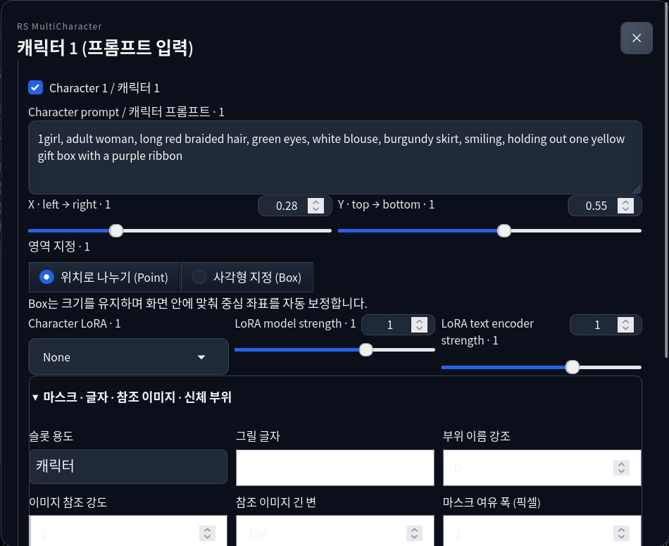

# RS MultiCharacter for Forge Neo — User guide

[한국어](user-guide.ko.md) · **English** · [日本語](user-guide.ja.md) · [简体中文](user-guide.zh-CN.md)

For **0.2.0a1 (alpha)**. This guide follows the shipped interface. Most extension labels are currently Korean or Korean/English; the labels below are the text to look for. Translating this guide does not change the interface language.

## Contents

1. [Install and update](#install)
2. [Make your first two-character image](#quick-start)
3. [Write prompts and assign regions](#prompts-regions)
4. [Use character LoRAs](#loras)
5. [Choose a mode and separation schedule](#schedules)
6. [Paint masks, emphasize body parts and place text](#masks-text)
7. [Edit 3D poses and use the pose library](#pose3d)
8. [Use reference images and learned pose](#references)
9. [Set interactions, camera and layout](#camera-layout)
10. [Use progressive resolution](#progressive)
11. [Run detailers, taggers and folder correction](#detailers)
12. [Restore PNGs, drag and drop, and exchange presets](#restore)
13. [Prepare optional dependencies and models](#models)
14. [Troubleshooting](#troubleshooting)
15. [Supported scope](#scope)

<a id="install"></a>
## 1. Install and update

Use **Forge Neo**. The tested host is neo-2.31, commit `4f4284b02a5c814b81c328c64ed7e99a139f21ef`, on Linux/Python 3.12. Other revisions and operating systems have not been validated in this release.

### Before installing

If you do not have Forge Neo, follow its [official installation instructions](https://github.com/Haoming02/sd-webui-forge-classic/tree/neo#installation) first. Prepare a checkpoint with its matching text encoder and VAE, and confirm that Forge can generate a normal image before adding the extension. See Forge's [model download guide](https://github.com/Haoming02/sd-webui-forge-classic/wiki/Download-Models) for each model's required files.

Choose **one of URL, Git or ZIP installation** below. The Forge directory contains `launch.py` and `extensions/`. Do not install this extension in ComfyUI's `custom_nodes/`.

### Method A: Install by URL in the WebUI

1. In Forge Neo, open **Extensions → Install from URL**.
2. Paste the URL below into **URL for extension's git repository**.
3. Leave **Specific branch name** and **Local directory name** empty, then click **Install**.
4. When installation finishes, open **Extensions → Installed** and check that `sd-forge-rs-multicharacter` is enabled.
5. Click **Apply and restart UI**. If it reads **Apply and quit**, start Forge again with your usual launcher after it exits. Reload the browser page too.

```text
https://github.com/raspie10032/sd-forge-rs-multicharacter
```

### Method B: Install with Git

With Git available, close Forge, run this **from the Forge directory**, then start Forge as usual. This creates the same Git-based installation as the URL method.

```bash
git clone https://github.com/raspie10032/sd-forge-rs-multicharacter.git extensions/sd-forge-rs-multicharacter
```

### Method C: Install a ZIP

1. Close Forge and download the extension ZIP for your chosen version from [Releases](https://github.com/raspie10032/sd-forge-rs-multicharacter/releases).
2. Extract it under Forge's `extensions/`, naming the extension folder `sd-forge-rs-multicharacter`.
3. Check that the file below exists, then start Forge. Avoid an extra nested extension folder.

```text
<Forge directory>/extensions/sd-forge-rs-multicharacter/scripts/rs_multicharacter.py
```

The `rs_forge_mc/` and `javascript/` folders must be beside `scripts/` too.

### Verify installation and update

In txt2img or img2img, expand **RS MultiCharacter · Forge Neo**, enable **멀티캐릭터 사용**, and click **캐릭터 1 (프롬프트 입력)**. An opening floating editor confirms that the interface loaded. Also generate the [two-character example in section 2](#quick-start) to check the generation path.

For URL/Git installations, use **Extensions → Installed → Check for updates**, select this extension's update, then apply and restart. ZIP installations cannot use Git updates: close Forge and replace the extension folder with the new ZIP's folder. Save JSON presets and any manually edited files separately before updating. If old controls remain, hard-refresh with **Ctrl+Shift+R**.

If the panel is missing, check folder nesting, its enabled state under Installed, and extension loading errors in Forge's terminal. If a reference or detailer reports missing dependencies, install only the relevant packages from [section 13](#models) using **Forge's Python**, then restart.

Basic sampling needs no additional extension-specific packages. Optional models are prepared when their feature runs; startup alone does not download weights. Model, encoder, VAE and LoRA weights are not bundled.

<a id="quick-start"></a>
## 2. Make your first two-character image

Start in **txt2img** with a compatible Anima 2B checkpoint, text encoder and VAE already installed.

1. Set **Width 1728, Height 1152, Euler a, SGM Uniform, Steps 24, CFG 4**, and a fixed seed such as `823401`. Use batch size/count 1 for the first comparison. Disable Hires.fix and leave optional features off.
2. Expand **RS MultiCharacter · Forge Neo** and check **멀티캐릭터 사용** (enable multi-character). Editing cards while this is off does not enable the extension.
3. Put the shared scene in Forge's normal Positive prompt and the common negative in Negative.
4. Click **캐릭터 1 (프롬프트 입력)** (Character 1, enter prompt). Enter its prompt, set **Point, X 0.28, Y 0.55**, and leave LoRA as **None**.
5. Close with **완료 / 닫기**. Open character 2, or use **+ 캐릭터 추가**, and set **Point, X 0.72, Y 0.55** with the second prompt. Keep both character checkboxes enabled.
6. Choose **precision**, leave the original separation schedule in place, and click Forge **Generate**.

Copyable example; these are starting prompts, not a guarantee of a particular output:

| Field | Text |
| --- | --- |
| Forge Positive | `2girls, two adult women, sharing one umbrella, standing outside a flower shop, rainy street, buckets of flowers, warm shop window light, full scene, anime illustration` |
| Forge Negative | `low quality, blurry, extra people, duplicate person, extra arms, extra fingers, watermark` |
| Character 1 | `1girl, adult woman, long red braided hair, green eyes, white blouse, burgundy skirt, standing on the left, holding the umbrella handle` |
| Character 2 | `1girl, adult woman, short blue bob hair, golden eyes, navy dress, cream cardigan, standing on the right, holding a bouquet with both hands` |

If you want to compare the scene-oriented settings used in the published examples, change only **Initial common prior → 0.5, Early character V gain → 1.0, Initial spatial separation → 0.2**. Keep hold steps `3` and decay `0.2`. This is an optional comparison, not the shipped default or a universal quality preset.


<a id="prompts-regions"></a>
## 3. Write prompts and assign regions

**Shared prompt:** background, lighting, composition, total people and shared action/props. **Character prompt:** that person's hair, eyes, clothes and role. For an exchange, describe one shared item in the common prompt, then assign giving and receiving to the respective characters. Repeating the entire group scene in every character prompt can make assignment harder.

The common Forge Negative applies to the generation. Per-character negative prompts are intentionally absent. A slot participates only when its checkbox is on **and its prompt is nonempty**. Up to ten slots are available; this is an input limit, not a promise of ten distinct people. txt2img and img2img have separate extension controls.

| Region control | Meaning |
| --- | --- |
| **Point / 위치로 나누기** | Divides the image by proximity to character coordinates. Start here for a simple left/right arrangement. |
| **Box / 사각형 지정** | Sets a rectangle using its center X/Y and width/height. Overlap can blend both characters' conditions. |
| **X, Y** | Normalized image coordinates: X `0` left, `1` right; Y `0` top, `1` bottom. |
| **Box width / height** | Fractions of the whole image. A width of `0.4` is 40% of the image width. These controls apply to Box. |

Boxes keep their size and shift their center back inside the canvas near an edge. The preview follows Forge's output ratio. Click a colored region or a character card to edit it; closing the floating form retains values. For exact silhouettes, use a mask or 3D scene.

<a id="loras"></a>
## 4. Use character LoRAs

Select a registered file in **Character LoRA**. If a newly added file is missing, click **Refresh LoRA list / LoRA 목록 새로고침**. Use a LoRA trained for the selected model family.

- **LoRA model strength:** diffusion-model contribution.
- **LoRA text encoder strength:** text-encoder contribution, when the file contains matching tensors.
- **None:** no character-specific LoRA. The first exercise works without one.

Do not put `<lora:...>`, `<lyco:...>` or `<hypernet:...>` inside a character prompt; these are rejected. Choose the file and strengths in the form. A LoRA applied globally through Forge is not a per-character assignment.

Extended adapters such as DoRA, LoHa, LoKr, GLoRA, OFT and IA³ depend on Forge's loader and the target layer. Unsupported shared Normal execution falls back to Precision; unmatched weights produce an error. Every trained adapter format has not been tested.

<a id="schedules"></a>
## 5. Choose a mode and separation schedule

**precision** calculates separate predictions for character LoRA configurations and combines them by region. It is the starting mode for checking separation; more distinct LoRAs can increase runtime. **normal** shares supported layer calculations and can be faster, with different mixing behavior. Modes need not produce identical images.

Open **고급 설정 / 분리 스케줄** (advanced separation schedule):

| Actual label | Default | Purpose |
| --- | --- | --- |
| Initial common prior | `0.05` | Initial share of the common prompt in routing. |
| Early character V gain | `1.7` | Early emphasis on character values. |
| Initial spatial separation | `0.9` | Initial spatial isolation between characters. |
| Boundary hold steps | `3` | How long the initial boundary is held. |
| Boundary decay per step | `0.2` | Boundary relaxation per step after the hold. |

**ComfyUI 기본 스케줄 적용** resets only these five values. It does not reset character prompts, LoRAs, masks or the whole extension. Imported PNG/preset values take priority over defaults.

Strong isolation can compete with backgrounds and shared contact. Try one schedule change at a time with the same seed. **추가 기능** also contains late common-prompt boost and region-edge feathering; these are separate controls.

<a id="masks-text"></a>
## 6. Paint masks, emphasize body parts and place text

In a character form, expand **마스크 · 글자 · 참조 이미지 · 신체 부위**.



**Paint/import a mask:** click **마스크 그리기 / 가져오기**. Paint white where the character belongs and keep the remainder black. Adjust the brush, use **지우개** to erase, or import a black/white image. Click **이 마스크 적용** to commit; **취소** discards that dialog's changes. Empty masks are rejected. **마스크 해제** removes the custom mask. A supplied mask replaces that slot's ordinary region; to return fully to Point/Box after using 3D, also clear the 3D scene.

**마스크 여유 폭 (픽셀)** expands the source mask in mask pixels. Offsets are canvas fractions; scale acts around the canvas center. Areas outside the canvas are clipped. These controls do not change the output resolution.

**부위 이름 강조** needs semantic parts from a 3D scene or **OpenPose JSON / 뼈대 PNG** in the common advanced panel. Start from `0` and increase only when supplying pose data. It emphasizes named body parts; it is distinct from a learned pose adapter. Advanced presets can also carry explicit body-part masks.

**Text:** change **슬롯 용도** to **글자 영역 (Box 필요)**, choose Box, fill **그릴 글자** with the literal text, and keep a nonempty slot prompt describing the sign/text region. Text slots do not use character LoRAs. Readable spelling depends on the model; text regions do not guarantee accurate letters.

<a id="pose3d"></a>
## 7. Edit 3D poses and use the pose library

1. Set the output width/height in Forge first.
2. Open **3D Pose / 기존 3D 포즈 편집기 → 3D 편집기 열기 / Open 3D editor**.
3. Edit the numbered people, joints and fingers; adjust the view for the intended silhouettes. Match person numbers to character slots.
4. Use the editor's library/import controls for saved poses and supported JSON, OpenPose/DWPose/Yu Zhu, BVH or ZIP data.
5. Click the fixed footer **캐릭터 영역에 적용 / Apply to character regions**. Closing the editor alone does not apply the scene.

The library is stored under Forge `models/rs_pose3d/`. The editor canvas follows Forge's aspect ratio. **3D 영역 해제 · 위치/박스로 전환** clears the scene and returns to coordinate regions; separately painted masks remain until cleared in their slots.

The default **실루엣 영역만** uses silhouettes as regions. This guides placement, not exact skeletal reproduction. To drive a learned pose adapter, follow the next section. The editor's orbit camera changes projection; the dedicated camera-condition panel is a separate feature.

**Image → 3D:** use **이미지→3D** in the editor with a clear crop containing one person. The first run may download about **2.83 GB** of SAM 3D Body weights. Inspect and correct the returned joints, then apply. Occluded limbs and depth can be wrong.

<a id="references"></a>
## 8. Use reference images and learned pose

Upload an image with **참조 이미지 넣기** in the relevant character form. Set **이미지 참조 강도** and **참조 이미지 긴 변**; `384` is the initial long-edge setting. **참조 해제** detaches it. In common **추가 기능 → 이미지 참조 방식**, select the model-appropriate method.

| Anima method | Restrictions to check |
| --- | --- |
| Reference frame | Matching 2B/2.9B adapter required; 2.9B has its own weights. |
| Asymmetric v2 | Experimental, Anima 2B only; character LoRAs are blocked because that combination is unvalidated upstream. |
| Role K/V | Anima 2B BF16/FP32; baseline interaction and body-part emphasis `0`. Character LoRAs require **normal**. |
| SigLIP IP-Adapter | Legacy path with its matching encoder/adapter dependencies. |

Reference Guidance, adapter strength, reference scale, correction and cache are method-specific settings; leave them initially unchanged. SD IP-Adapter and native FLUX/Krea/MOSS reference paths exist, but trained-checkpoint generation for those paths was not validated in this release.

**Learned pose:** apply a 3D scene, then open **3D 학습된 자세 유도 → 자세 적용** and select **학습된 모델별 자세 어댑터** (`auto`). Set strength and start/end fractions; end must follow start. Supported original adapter families are Anima, Krea 2 and MOSS, with matching weights; the Anima adapter requires the matching 2B architecture.

**Use image references or learned pose one at a time.** Learned pose also requires full resolution: progressive start scale must be `1`. A silhouette-only scene is not the same as enabling learned pose.

Reference assets are stored locally in `models/rs_mc/assets/`; PNGs/presets store asset IDs, not the images. Uploads must be single images of at most 24 megapixels and are prepared as RGB with a maximum long edge of 2048. Keep your original files separately, and upload references again on another installation.

<a id="camera-layout"></a>
## 9. Set interactions, camera and layout

Open **추가 기능 / 마스크·카메라·참조·디테일러**.

- **상호작용 · 겹침 제어:** baseline, 3 extra steps, 6 extra steps, or custom boundary hold/decay. This adjusts overlap scheduling. Describe the action in prompts; it does not solve hand contact or shared objects automatically.
- **카메라 조건:** enable it, then set azimuth, elevation, distance, roll and strength. Choose scene-only or scene-and-characters scope. **영역 좌표 동기화** can keep coordinates fixed or transform them with distance/roll or perspective.
- **프롬프트 문법:** default or NovelAI weighting syntax. This interprets prompt weights; it does not call the NovelAI service.
- **레이아웃 방식:** use regional routing normally. **MOSS 기본 레이아웃 JSON** is MOSS-only and needs a Box or mask for every participating slot, default ComfyUI syntax, no image references, and character text-encoder LoRA strengths of `0`. Selecting it with another model stops with an explanation. Auto chooses the model-specific route.

<a id="progressive"></a>
## 10. Use progressive resolution

Keep Forge's width/height at the final size. In **점진 해상도 · 시작 배율 (1 = 끄기)**, `1` disables progressive sampling; `0.5–<1` starts smaller and grows the latent in three stages along one sigma schedule.

Use the progressive route in **txt2img**, with **Hires.fix off**. Masked inpainting needs fixed resolution. Disable learned pose, which requires full resolution. Solver history restarts between stages, so this is not equivalent to an ordinary full-resolution run. Do not treat it as a guaranteed VRAM fix: the final stage still reaches the requested size.

<a id="detailers"></a>
## 11. Run detailers, taggers and folder correction

Install the optional dependencies and place/select detector weights first ([model setup](#models)). In **추가 기능 → 로컬 디테일러 · 태거**:

1. Enable **생성 후 디테일러 사용**.
2. Choose **SEGM 감지 모델** or **BBOX 감지 모델**. SEGM takes priority and bypasses BBOX/SAM. With BBOX, SAM is optional and needs a local ViT-H/L/B checkpoint.
3. Choose a character-matching tagger. Start with WD ViT v3 when using the existing Forge environment.
4. Set correction denoise, crop size, steps and CFG. Initial values are `0.35`, `768`, `20`, `4`.
5. Generate. Confidently matched detections are corrected through masked img2img with the selected character's prompt/LoRA and composited inside the mask. Ambiguous matches are skipped; lowering matching thresholds can assign the wrong character.

**Tag a reference:** upload one in a character form and press **참조 이미지 태그 분석**. The selected WD/PixAI tagger returns tags and scores; inspect them and copy useful tags into your prompt. It does not automatically replace the prompt. Taggers and YOLO detection run on CPU in this port; diffusion and image-to-3D use Forge's selected GPU.

**Folder correction:** under **로컬 폴더 일괄 보정**, enter separate input/output folders on the **Forge server's filesystem**, configure and enable the detailer, then press **폴더 이미지 보정 시작**. It uses the current characters, common Positive/Negative, model and correction settings, not each input image's embedded generation settings.

It processes 1–512 PNG/WebP/JPG/JPEG files directly inside the input folder, without recursion. Results are separate `original-name.ext.rs-detail.png` files. Existing outputs cause an error rather than an overwrite. A failure or cancellation can leave already completed outputs; use another output folder when retrying. Other generation jobs share the same queue.

<a id="restore"></a>
## 12. Restore PNGs, drag and drop, and exchange presets

**Native Forge PNG:** open **PNG Info**, upload the original generated PNG, then press **Send to txt2img** or **Send to img2img**. Inspect the restored RS panel and floating forms before generating.

**Drag and drop:** drop the original PNG onto Forge's **Positive prompt field**, then press Forge's **restore generation parameters** button. Dropping it into the img2img image canvas supplies an input image; use the restoration action to load generation settings as well.

Forge's normal `parameters` metadata includes the common generation settings and an **`RS MultiCharacter` JSON** field for the extension. Restoration includes slots, prompts, LoRA names/strengths, regions, schedules, mode, 3D scene and advanced state. Screenshots and images with stripped metadata cannot restore these values.

**JSON preset:** open **Presets / JSON 프리셋**, click **Export settings / 설정 내보내기**, and copy/save the displayed JSON. Paste it back and click **Import settings / 설정 불러오기** to restore. This preset is the extension's configuration; use a native PNG to restore Forge's common prompt, seed, sampler and resolution together.

**ComfyUI/NAI exchange:** use **추가 기능 → OpenPose / 원본 PNG·NAI 설정 가져오기 → ComfyUI·NAI PNG / JSON 가져오기**. This imports recognized RS character settings into the extension; verify Forge's common generation controls separately. **NAI 호환 JSON 내보내기** downloads a compatible settings file. It does not execute a ComfyUI graph, invoke the NAI API or restore model weights.

The destination installation must have the named model/LoRA files. Reference IDs require their local assets; re-upload references on another PC. Restoring the same seed across apps does not guarantee identical pixels.

<a id="models"></a>
## 13. Prepare optional dependencies and models

Run commands from the Forge folder using **the Python interpreter Forge actually uses**. In a venv, replace `python` with that venv's interpreter; Windows portable builds may use a bundled interpreter. Keep Forge's working torch/torchvision. Do not install `requirements-dev.txt` into Forge.

```bash
# Image references, when missing dependencies are reported
python -m pip install -r extensions/sd-forge-rs-multicharacter/requirements-reference.txt

# Detailers and WD taggers
python -m pip install -r extensions/sd-forge-rs-multicharacter/requirements-detailer.txt
```

PixAI Tagger v1.0 needs **Transformers 5**. Use a separate Forge environment whose compatibility you have checked before installing `requirements-pixai-tagger.txt`; it can change a dependency used by Forge itself. WD taggers do not require that optional upgrade.

| Path below Forge `models/` | Contents |
| --- | --- |
| `rs_mc/assets/` | Uploaded reference image assets. |
| `rs_pose3d/` | Pose library. |
| `ultralytics/segm/`, `ultralytics/bbox/` | Detector weights. |
| `sams/` | Optional local SAM checkpoints. |
| `rs_wd_tagger/` | Tagger files. |
| `detection/` | Image-to-3D model files. |

Reference/pose adapters use their family-specific model directories. Missing supported weights may be downloaded on first feature use; local SAM files must be supplied. For reuse, open **Settings → RS MultiCharacter → RS additional model directories** and add a ComfyUI **models root**, keeping its subfolder structure. Separate multiple roots with `:` on Linux or `;` on Windows, then apply settings. This setting is for auxiliary model lookup; character LoRAs must still appear in Forge's own LoRA list.

<a id="troubleshooting"></a>
## 14. Troubleshooting

| Symptom | Check |
| --- | --- |
| No panel / old controls | Correct ZIP directory, extension enabled, full Forge restart, hard browser refresh. Check Forge's console for load errors. |
| Prompts seem ignored | Main **멀티캐릭터 사용**, each character checkbox, nonempty prompts, correct txt2img/img2img tab. |
| Background weak / identities mix | Fix the seed; check common versus character prompts, geometry and schedule separately. Compare original defaults with the optional scene settings. |
| Too many/few people or wrong roles | Reduce scene complexity and inspect regions. Both original ComfyUI and Forge can fail at higher counts; ten slots do not enforce ten people. |
| Region controls do not affect the mask | Check custom masks and applied 3D scene; clear them to return to ordinary Point/Box. |
| LoRA missing / unmatched weights | Refresh Forge's LoRA list, verify model family and exact registered name. Read the weight mismatch error. |
| Reference/pose combination rejected | Check the restrictions in [section 8](#references); these exclusions also exist in the original. |
| Detailer makes no changes | Ensure enabled + SEGM/BBOX selected; verify detections and match score/margin. Ambiguous detections are intentionally preserved. |
| Folder path cannot be found | Use a path on the Forge server, a different output folder and 1–512 supported files at the top level. |
| PNG settings do not restore | Original metadata-bearing PNG, correct restore action, extension installed, required LoRAs and reference assets present. |
| Out of memory / very slow | Reduce resolution, batch and optional features; Precision with many LoRAs adds work. Progressive still has a full-size final stage. |

For an issue report, include extension/Forge versions, model family, mode, sampler/scheduler, size, steps, seed, enabled optional features, exact error and a minimal reproducible preset/PNG. Check private prompts/reference content before sharing.

<a id="scope"></a>
## 15. Supported scope

Actual-checkpoint generation tests primarily cover **Anima 2B**. Other native model families have small random-weight execution checks, which do not establish trained-model quality. Tested core Anima predictions match ComfyUI for identical encoded inputs; independent end-to-end PNG identity and every optional-feature combination are not established.

App Mode and per-character negatives are omitted. FLUX3 cannot run on the tested Forge host because it lacks that engine. Nunchaku is rejected. Quantized/GGUF combinations, other attention-replacement extensions, ControlNet combinations and other OSes remain unverified. Masks, poses and references guide a model; exact people counts, identity, contact, anatomy and text are not guaranteed.

[Feature matrix](feature-parity.md) · [Validation and known limits](validation.md) · [Advanced technical setup](advanced.md) · [Repository](../README.md)
