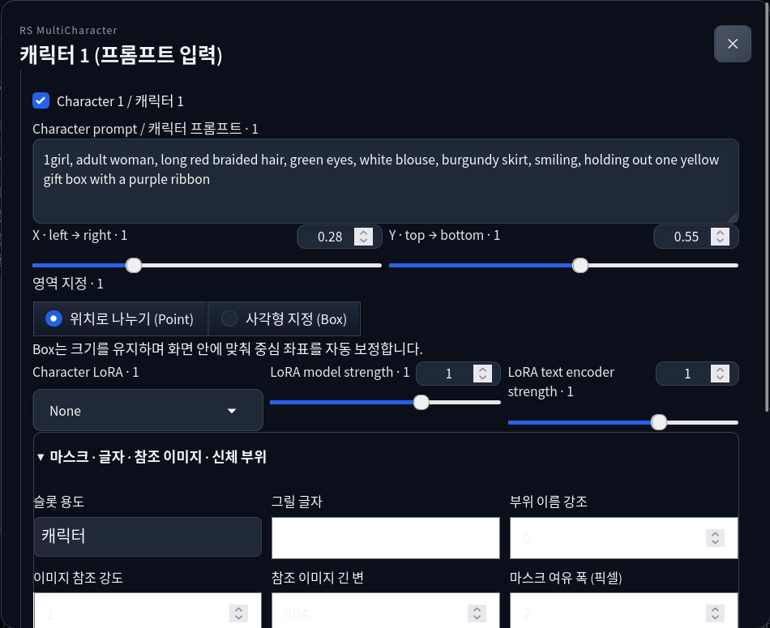

# RS MultiCharacter for Forge Neo — 用户指南

[한국어](user-guide.ko.md) · [English](user-guide.md) · [日本語](user-guide.ja.md) · **简体中文**

适用于 **0.2.0a1（Alpha）**。本文按照当前发布版界面编写。扩展界面目前主要使用韩文或韩英双语，因此保留实际按钮名称，方便定位。指南翻译不代表界面已完成本地化。

## 目录

1. [安装与更新](#install)
2. [生成第一张双人图](#quick-start)
3. [提示词与区域分配](#prompts-regions)
4. [角色独立 LoRA](#loras)
5. [Normal、Precision 与分离调度](#schedules)
6. [蒙版、身体部位与文字区域](#masks-text)
7. [3D 编辑与姿势库](#pose3d)
8. [参考图与学习式姿势引导](#references)
9. [互动、相机与布局](#camera-layout)
10. [渐进分辨率](#progressive)
11. [细节修复、标签分析与文件夹批处理](#detailers)
12. [PNG、拖放与 JSON 设置恢复](#restore)
13. [可选依赖与模型准备](#models)
14. [常见问题](#troubleshooting)
15. [支持范围](#scope)

<a id="install"></a>
## 1. 安装与更新

本扩展面向 **Forge Neo**。已验证的宿主为 Linux/Python 3.12 下的 neo-2.31，提交 `4f4284b02a5c814b81c328c64ed7e99a139f21ef`。其他宿主版本尚未验证。Windows BAT 安装流程单独测试，不代表已验证 Windows 上的实际生成。

### 安装前准备

如果尚未安装 Forge Neo，请先按照 [Forge Neo 官方安装说明](https://github.com/Haoming02/sd-webui-forge-classic/tree/neo#installation)完成安装。准备检查点及匹配的编码器和 VAE，并在安装扩展前确认 Forge 本身可以正常生成图片。各模型所需文件请参考 [Forge 官方模型指南](https://github.com/Haoming02/sd-webui-forge-classic/wiki/Download-Models)。

在下方 **Windows BAT、URL、Git、ZIP 中任选一种**。Forge 目录指包含 `launch.py` 和 `extensions/` 的目录；本扩展不应安装到 ComfyUI 的 `custom_nodes/` 中。

<a id="windows-bat"></a>
### Windows 推荐：一个 BAT 完成安装与更新

1. **完全退出 Forge Neo 及其启动终端。** 只关闭浏览器标签页并不会停止 Forge。
2. 下载 **[Install-RS-MultiCharacter.bat](https://github.com/raspie10032/sd-forge-rs-multicharacter/releases/download/v0.2.0a2/Install-RS-MultiCharacter.bat)**。通常不需要 Git 或管理员权限。
3. 双击 BAT，粘贴 Forge 路径，或按 **Enter** 打开文件夹选择器。
4. 选择**包含 `launch.py` 的 Forge Neo 目录**。选择便携版的外层目录时，安装器也会查找其中的 `webui`。不要选择模型目录或 ComfyUI。
5. 安装器下载最新公开版本（**包括 Alpha**），验证 SHA-256 后安装。显示 **Installed** 后，用平时的启动器开启 Forge，再在浏览器按 **Ctrl+Shift+R**。BAT 不会自动启动 Forge。

检测到运行中的 Forge/WebUI 时，安装器会提示先退出并停止安装，不会强制终止进程。下载、校验和压缩包验证在替换旧扩展前完成；替换失败时恢复原目录。

旧扩展整体备份到 **`<Forge>/.rs-mc-backups/sd-forge-rs-multicharacter-日期-ID/`**，不会作为第二个扩展加载。Forge 设置、模型、姿势库、参考文件及其他扩展保持不变。扩展内部的手动修改保存在备份中。需要回退时，先退出 Forge，将当前扩展目录移到其他位置，再把所选备份移回 `extensions/sd-forge-rs-multicharacter`。

**更新时也先退出 Forge，再运行同一个 BAT。** BAT 使用发布 ZIP 安装方式；替换 URL/Git 安装后，`.git` 也会保存在备份中，之后请用 BAT 更新。如需继续使用 Git 更新，请保留下方的 URL/Git 安装方式。

BAT **只安装本扩展**，不安装 Forge Neo 本体、检查点、可选功能依赖或权重，也不修改 GPU 选择、启动参数或浏览器自动打开设置。可选功能见[第 13 节](#models)。Linux 请使用下方 URL/Git/ZIP 方式。

### 方式 A：在 WebUI 中通过 URL 安装

1. 在 Forge Neo 中打开 **Extensions → Install from URL**。
2. 将下方地址粘贴到 **URL for extension's git repository**。
3. **Specific branch name** 和 **Local directory name** 留空，点击 **Install**。
4. 完成后在 **Extensions → Installed** 中确认 `sd-forge-rs-multicharacter` 已启用。
5. 点击 **Apply and restart UI**。如果按钮显示为 **Apply and quit**，退出后用平时的启动器重新启动 Forge。也请刷新浏览器。

```text
https://github.com/raspie10032/sd-forge-rs-multicharacter
```

### 方式 B：使用 Git 安装

在已安装 Git 的环境中，退出 Forge，**从 Forge 目录**执行以下命令，然后照常启动。此方式与 URL 安装一样，由 Git 管理扩展。

```bash
git clone https://github.com/raspie10032/sd-forge-rs-multicharacter.git extensions/sd-forge-rs-multicharacter
```

### 方式 C：使用 ZIP 安装

1. 退出 Forge，从 [Releases](https://github.com/raspie10032/sd-forge-rs-multicharacter/releases) 下载所需版本的扩展 ZIP。
2. 解压到 Forge 的 `extensions/` 下，将扩展目录命名为 `sd-forge-rs-multicharacter`。
3. 确认下列文件存在，再启动 Forge。避免多嵌套一层扩展目录。

```text
<Forge 目录>/extensions/sd-forge-rs-multicharacter/scripts/rs_multicharacter.py
```

`scripts/` 同级还需包含 `rs_forge_mc/` 和 `javascript/`。

### 确认安装与更新

在 txt2img 或 img2img 中展开 **RS MultiCharacter · Forge Neo**，勾选 **멀티캐릭터 사용**，点击 **캐릭터 1 (프롬프트 입력)**。浮动输入窗口能打开，说明界面已加载。请再用[第 2 节的双人示例](#quick-start)确认实际生成。

URL/Git 安装请使用 **Extensions → Installed → Check for updates**，选择本扩展的更新后应用并重启。ZIP 安装无法使用 Git 更新：请退出 Forge，用新版 ZIP 中的扩展目录替换旧目录。更新前另行保存 JSON 预设和手动修改的文件。仍显示旧界面时，使用 **Ctrl+Shift+R** 强制刷新。

如果面板未出现，请检查目录嵌套、Installed 中的启用状态，以及 Forge 启动终端中的扩展加载错误。参考图或细节修复提示依赖缺失时，使用 **Forge 的 Python** 安装[第 13 节](#models)对应的依赖，然后重启。

基础生成无需额外安装本扩展专用依赖。可选权重在运行对应功能时准备，仅启动不会下载。发布包不含检查点、编码器、VAE 或 LoRA 权重。

<a id="quick-start"></a>
## 2. 生成第一张双人图

准备 **Anima 2B** 检查点及匹配的编码器和 VAE，从 **txt2img** 开始。

1. 设置 **宽 1728、高 1152、Euler a、SGM Uniform、24 步、CFG 4**，固定种子 `823401`。首次比较将批次大小及次数设为 1，关闭 Hires.fix 和可选功能。
2. 展开 **RS MultiCharacter · Forge Neo**，勾选 **멀티캐릭터 사용**（启用多角色）。关闭时仍可编辑卡片，但不会应用到生成。
3. Forge 常规 Positive 中填写共享场景，Negative 中填写共享负面提示词。
4. 点击 **캐릭터 1 (프롬프트 입력)**（角色 1，输入提示词），填写提示词，设置 **Point、X 0.28、Y 0.55**，LoRA 保持 **None**。
5. 用 **완료 / 닫기** 关闭，再打开角色 2；需要时用 **+ 캐릭터 추가** 添加。填写第二个提示词，设为 **Point、X 0.72、Y 0.55**，保持两个角色均勾选。
6. 选择 **precision**，保留原版分离调度默认值，点击 Forge **Generate**。

以下提示词可直接复制作为起点，并不保证生成某张固定图像。

| 输入栏 | 提示词 |
| --- | --- |
| Forge Positive | `2girls, two adult women, sharing one umbrella, standing outside a flower shop, rainy street, buckets of flowers, warm shop window light, full scene, anime illustration` |
| Forge Negative | `low quality, blurry, extra people, duplicate person, extra arms, extra fingers, watermark` |
| 角色 1 | `1girl, adult woman, long red braided hair, green eyes, white blouse, burgundy skirt, standing on the left, holding the umbrella handle` |
| 角色 2 | `1girl, adult woman, short blue bob hair, golden eyes, navy dress, cream cardigan, standing on the right, holding a bouquet with both hands` |

若要对比公开示例使用的场景参数，只修改 **Initial common prior `0.5`、Early character V gain `1.0`、Initial spatial separation `0.2`**。保持步数 `3`、衰减 `0.2` 不变。这是可选对比，并非发布默认值或适用于所有场景的质量预设。


<a id="prompts-regions"></a>
## 3. 提示词与区域分配

**共享提示词**描述背景、光照、构图、总人数、共同动作和共享道具。**角色提示词**描述该角色的头发、眼睛、服装和分工。传递物品时，在共享栏写明一个共同物品，再分别指定递出与接收。每个角色栏都重复整个多人场景，可能让角色分配更困难。

负面提示词使用 Forge 共享 Negative；独立角色负面提示词未纳入本扩展。角色槽位需要**已勾选且提示词非空**才会参与。最多 10 个槽位是输入上限，不保证恰好生成 10 人。txt2img 与 img2img 的扩展设置互相独立。

| 区域设置 | 含义 |
| --- | --- |
| **按位置分区 / 위치로 나누기 (Point)** | 按像素位置与各角色坐标的距离划分区域，适合先检查简单左右布局。 |
| **矩形 / 사각형 지정 (Box)** | 使用中心 X/Y、宽和高指定矩形；重叠部分可能混合两人的条件。 |
| **X、Y** | 归一化图像坐标。X 从左 `0` 到右 `1`，Y 从上 `0` 到下 `1`。 |
| **Box width / height** | 占整幅图像的比例。宽 `0.4` 表示图像宽度的 40%，仅用于 Box。 |

靠近边缘时，Box 保持尺寸并自动修正中心，使其处于画布内。预览跟随 Forge 输出宽高比。点击彩色区域或角色卡片可打开浮动输入窗，关闭后保留数值。需要轮廓时，使用蒙版或 3D 场景。

<a id="loras"></a>
## 4. 角色独立 LoRA

在 **Character LoRA** 中选择 Forge 已登记的文件。新增文件未显示时，点击 **Refresh LoRA list / LoRA 목록 새로고침**。请使用与当前模型系列匹配的 LoRA。

- **LoRA model strength：**扩散模型部分的强度。
- **LoRA text encoder strength：**文件含匹配张量时，文本编码器部分的强度。
- **None：**不使用角色独立 LoRA；首次练习无需 LoRA。

角色提示词中不支持 `<lora:...>`、`<lyco:...>`、`<hypernet:...>`，输入后会报错。请使用选择栏和强度设置。通过 Forge 全局应用的 LoRA 不等于角色独立分配。

DoRA、LoHa、LoKr、GLoRA、OFT、IA³ 等扩展格式取决于 Forge 加载器和目标层。无法共享 Normal 计算时会转为 Precision；不匹配的权重会明确报错。并非所有训练后适配器组合都经过实测。

<a id="schedules"></a>
## 5. Normal、Precision 与分离调度

**precision** 按角色 LoRA 配置分别预测，再按区域合成，适合作为检查分离效果的起点；不同 LoRA 越多，运行可能越慢。**normal** 共享受支持层的计算，可能更快，但特征混合方式不同。两个模式不必生成相同图像。

打开 **고급 설정 / 분리 스케줄**（高级设置／分离调度）。

| 实际界面名称 | 默认值 | 作用 |
| --- | --- | --- |
| Initial common prior | `0.05` | 初始路由中的共享提示词比重。 |
| Early character V gain | `1.7` | 早期角色值的强调程度。 |
| Initial spatial separation | `0.9` | 初始角色空间隔离程度。 |
| Boundary hold steps | `3` | 保持初始边界的步数。 |
| Boundary decay per step | `0.2` | 保持阶段结束后，每步放松边界的量。 |

**ComfyUI 기본 스케줄 적용** 只重置以上五项，不会重置角色提示词、LoRA、蒙版或整个扩展。导入 PNG／预设时，以文件中保存的值为准。

强分离可能与背景或共同动作产生冲突。固定种子，每次只调整一项。**추가 기능** 中的后期共享提示词增量和区域边缘羽化是独立设置。

<a id="masks-text"></a>
## 6. 蒙版、身体部位与文字区域

展开角色输入窗中的 **마스크 · 글자 · 참조 이미지 · 신체 부위**（蒙版、文字、参考图、身体部位）。



**蒙版：**点击 **마스크 그리기 / 가져오기**。用白色涂角色所在区域，其余保持黑色。调整画笔、使用 **지우개**（橡皮擦）或导入黑白图，再点 **이 마스크 적용** 应用。**취소** 放弃本次对话框修改。空蒙版会被拒绝。**마스크 해제** 移除自定义蒙版。有蒙版时会替代该槽位的普通区域；若也用过 3D，要完全回到 Point/Box，还需清除 3D 场景。

**마스크 여유 폭 (픽셀)** 按原始蒙版像素扩张区域。偏移按画布比例，缩放围绕画布中心，超出部分会被裁切。这些设置不改变输出分辨率。

**부위 이름 강조**（身体部位名称强调）需要 3D 场景，或共享附加面板中的 **OpenPose JSON / 뼈대 PNG** 提供语义部位。从 `0` 开始，在提供姿势后再提高。部位强调与学习式姿势适配器是不同功能。高级预设也可包含显式部位蒙版。

**文字：**将 **슬롯 용도** 改为 **글자 영역 (Box 필요)**（文字区域，需要 Box），设置 Box 并在 **그릴 글자** 输入实际文字。槽位提示词也要保留对招牌或文字区域的非空描述。文字槽位不使用角色 LoRA。拼写是否准确取决于模型，不保证文字可读。

<a id="pose3d"></a>
## 7. 3D 编辑与姿势库

1. 先在 Forge 设置最终宽高。
2. 打开 **3D Pose / 기존 3D 포즈 편집기 → 3D 편집기 열기 / Open 3D editor**。
3. 编辑各编号人物、关节与手指，调整视角以得到所需轮廓。人物编号应对应角色槽位编号。
4. 使用姿势库及导入功能，读取保存姿势和受支持的 JSON、OpenPose/DWPose/Yu Zhu、BVH、ZIP。
5. 点击底部固定的 **캐릭터 영역에 적용 / Apply to character regions**。只关闭编辑器不会应用。

姿势库位于 Forge 的 `models/rs_pose3d/`，编辑画布跟随 Forge 宽高比。**3D 영역 해제 · 위치/박스로 전환** 清除 3D 场景；手绘蒙版需在各槽位单独清除。

默认 **실루엣 영역만** 仅将轮廓作为区域，不保证精确复现关节姿势。学习式姿势在下一节开启。编辑器环绕相机改变投影，与独立相机条件面板不同。

**图像→3D：**在编辑器的 **이미지→3D** 中使用清晰单人裁剪图。首次可能下载约 **2.83 GB** 的 SAM 3D Body 权重。检查并修正返回的关节，再应用。遮挡肢体和深度可能估计错误。

<a id="references"></a>
## 8. 参考图与学习式姿势引导

在对应角色中用 **참조 이미지 넣기** 上传，设置 **이미지 참조 강도**（强度）和 **참조 이미지 긴 변**（长边，初始值 `384`）。用 **참조 해제** 解除。共享 **추가 기능 → 이미지 참조 방식** 中选择适合模型的方法。

| Anima 方法 | 限制 |
| --- | --- |
| Reference frame | 需要匹配 2B／2.9B 结构的适配器；2.9B 使用专用权重。 |
| Asymmetric v2 | 实验性，仅限 Anima 2B；原版未验证角色 LoRA 组合，因此会阻止此组合。 |
| Role K/V | Anima 2B BF16/FP32；互动使用 baseline，部位强调为 `0`。使用角色 LoRA 时需要 **normal**。 |
| SigLIP IP-Adapter | 旧方法，需要对应编码器与适配器依赖。 |

Guidance、适配器强度、参考倍率、校正和缓存属于方法专用设置，首次请保持不变。SD IP-Adapter 及 FLUX/Krea/MOSS 参考路径已接入，但本次发布未用对应训练后检查点验证生成。

**学习式姿势：**先应用 3D 场景，然后在 **3D 학습된 자세 유도 → 자세 적용** 选择 **학습된 모델별 자세 어댑터**（`auto`）。设置强度与起止比例，结束必须晚于开始。原版适配器支持 Anima、Krea 2 和 MOSS，需要匹配权重；Anima 适配器要求对应 2B 结构。

**参考图和学习式姿势不能同时使用。** 学习式姿势还要求完整分辨率，因此渐进起始倍率须为 `1`。仅应用轮廓场景不会自动启用学习式姿势。

参考图资源保存在本地 `models/rs_mc/assets/`，PNG／预设只保存资源 ID。上传须为不超过 2400 万像素的单张图像，保存时转为 RGB，长边最大 2048。请单独保留原文件，换一套安装环境时重新上传参考图。

<a id="camera-layout"></a>
## 9. 互动、相机与布局

打开 **추가 기능 / 마스크·카메라·참조·디테일러**（附加功能）。

- **상호작용 · 겹침 제어：**baseline、额外保持 3／6 步，或自定义边界保持与衰减。它调整重叠调度；动作仍需写在提示词中，不会自动解决手部接触或共享道具。
- **카메라 조건：**启用后设置水平角、垂直角、距离、roll 和强度，可用于共享部分或共享＋角色。**영역 좌표 동기화** 可选固定、距离与旋转、透视投影。
- **프롬프트 문법：**默认或 NovelAI 权重语法。这是权重解释，不会调用 NovelAI 服务。
- **레이아웃 방식：**一般使用区域计算。**MOSS 기본 레이아웃 JSON** 仅限 MOSS，所有参与槽位都需要 Box 或蒙版，还须使用默认 ComfyUI 语法、不使用参考图，并将角色文本编码器 LoRA 强度设为 `0`。其他模型会显示原因并停止。自动选择按模型决定路径。

<a id="progressive"></a>
## 10. 渐进分辨率

Forge 的宽高保持最终尺寸。**점진 해상도 · 시작 배율 (1 = 끄기)** 中，`1` 表示关闭，`0.5 至小于 1` 表示从较小 latent 开始，沿同一 sigma 调度分三个阶段放大。

在 **txt2img 中关闭 Hires.fix** 使用。蒙版重绘需要固定分辨率。学习式姿势需要完整分辨率，也要关闭。阶段间会重新开始求解器历史，因此不等于普通全分辨率生成。最终阶段仍达到目标尺寸，不能保证解决显存不足。

<a id="detailers"></a>
## 11. 细节修复、标签分析与文件夹批处理

先准备[可选依赖与模型](#models)，打开 **추가 기능 → 로컬 디테일러 · 태거**。

1. 勾选 **생성 후 디테일러 사용**（生成后细节修复）。
2. 选择 **SEGM 감지 모델** 或 **BBOX 감지 모델**。SEGM 优先，会跳过 BBOX／SAM。BBOX 的 SAM 可选，需要本地 ViT-H/L/B 权重。
3. 选择角色匹配标签模型；现有 Forge 环境可先使用 WD ViT v3。
4. 设置修复 denoise、裁剪尺寸、步数和 CFG，初始值分别为 `0.35`、`768`、`20`、`4`。
5. 生成。匹配明确的检测区域会使用该角色提示词和 LoRA 进行蒙版 img2img 修复，并合成回蒙版内。模糊匹配会跳过；降低匹配阈值可能分配到错误角色。

**参考图标签分析：**上传参考图后点击 **참조 이미지 태그 분석**。查看所选 WD/PixAI 的标签与分数，将有用内容复制到提示词，不会自动替换提示词。本移植版标签分析与 YOLO 检测在 CPU 上执行；扩散生成及图像→3D 使用 Forge 选择的 GPU。

**文件夹修复：**在 **로컬 폴더 일괄 보정** 输入 **Forge 服务器文件系统**上的不同输入／输出路径。先启用并配置修复功能，再点击 **폴더 이미지 보정 시작**。使用当前角色、共享 Positive/Negative、模型及修复设置，而不是逐图读取原生成参数。

仅处理输入文件夹直属的 1–512 张 PNG/WebP/JPG/JPEG，不递归。结果文件名为 `原文件名.ext.rs-detail.png`。发现已有结果时会报错停止，不覆盖。失败或取消前已完成的输出可能保留；重试请换输出文件夹。它与其他生成任务共用队列。

<a id="restore"></a>
## 12. PNG、拖放与 JSON 设置恢复

**Forge 原始 PNG：**在 **PNG Info** 上传生成原图，点击 **Send to txt2img / Send to img2img**。再次生成前检查 RS 面板和角色浮窗中的恢复值。

**拖放：**将原始 PNG 拖到 Forge **Positive 提示词输入框**，然后点击 Forge 的**恢复生成参数按钮**。拖到 img2img 图像画布只是在指定输入图像；要同时加载设置，还需要执行恢复操作。

Forge 标准 `parameters` 元数据同时包含共享生成设置和扩展的 **`RS MultiCharacter` JSON**。可恢复槽位、提示词、LoRA 名称／强度、区域、调度、模式、3D 场景与附加状态。截图或已删除元数据的图片无法恢复。

**JSON 预设：**打开 **Presets / JSON 프리셋**，点击 **Export settings / 설정 내보내기**，复制保存显示的 JSON。粘贴后点击 **Import settings / 설정 불러오기** 即可恢复。这是扩展配置；如需连同 Forge 共享提示词、种子、采样器、分辨率一起恢复，请使用原始 PNG。

**ComfyUI／NAI 交换：**使用 **추가 기능 → OpenPose / 원본 PNG·NAI 설정 가져오기 → ComfyUI·NAI PNG / JSON 가져오기**。它将可识别的 RS 角色配置导入扩展，Forge 常规生成设置需要单独检查。**NAI 호환 JSON 내보내기** 下载兼容配置文件。不会执行 ComfyUI 图、调用 NAI API 或恢复模型权重。

目标安装仍需具备同名模型／LoRA 文件。参考 ID 依赖对应本地资源，换电脑时请重新上传。跨应用使用相同种子不保证像素一致。

<a id="models"></a>
## 13. 可选依赖与模型准备

在 Forge 文件夹中使用 **Forge 实际使用的 Python** 运行命令。venv 或 Windows portable 请将 `python` 替换为相应解释器。保留正常工作的 torch/torchvision，不要将开发用 `requirements-dev.txt` 安装到 Forge。

```bash
# 参考图功能报告缺少依赖时
python -m pip install -r extensions/sd-forge-rs-multicharacter/requirements-reference.txt

# 细节修复和 WD 标签模型
python -m pip install -r extensions/sd-forge-rs-multicharacter/requirements-detailer.txt
```

PixAI Tagger v1.0 要求 **Transformers 5**。它可能改变 Forge 自身依赖，因此仅在已确认兼容的独立 Forge 环境中使用 `requirements-pixai-tagger.txt`。WD 标签模型不需要这项可选升级。

| Forge `models/` 下路径 | 用途 |
| --- | --- |
| `rs_mc/assets/` | 上传的参考图资源。 |
| `rs_pose3d/` | 姿势库。 |
| `ultralytics/segm/`、`ultralytics/bbox/` | 检测权重。 |
| `sams/` | 可选本地 SAM 权重。 |
| `rs_wd_tagger/` | 标签模型文件。 |
| `detection/` | 图像→3D 模型。 |

参考与姿势适配器使用各模型系列专用目录。缺失的受支持权重可能在首次运行时下载；本地 SAM 文件需自行准备。复用 ComfyUI 模型时，在 **Settings → RS MultiCharacter → RS additional model directories** 添加保持原子目录结构的 **models 根目录**并应用设置。多个根目录在 Linux 用 `:`、Windows 用 `;` 分隔。这是辅助模型搜索设置；角色 LoRA 仍须出现在 Forge 自己的列表中。

<a id="troubleshooting"></a>
## 14. 常见问题

| 现象 | 检查事项 |
| --- | --- |
| 没有面板／仍是旧界面 | ZIP 层级、扩展已启用、完整重启 Forge、强制刷新、服务器加载错误。 |
| 角色提示词被忽略 | 总开关、各角色勾选、非空提示词、txt2img/img2img 对应标签页。 |
| 背景弱／外观混合 | 固定种子，分别检查共享／角色提示词、区域与调度，对比默认值和场景参数。 |
| 人数或角色动作错误 | 简化场景并检查区域；ComfyUI 与 Forge 都可能在多人时失败。 |
| 坐标修改不影响区域 | 检查并解除自定义蒙版及已应用的 3D 场景。 |
| LoRA 缺失／权重不匹配 | 刷新列表、模型系列、准确登记名和错误内容。 |
| 参考或姿势组合被拒绝 | 查看[第 8 节](#references)的互斥、结构及模式限制。 |
| 修复没有变化 | 开关、SEGM/BBOX、实际检测及匹配标准；不明确的区域会保留原样。 |
| 找不到文件夹 | 使用服务器路径、不同输出目录，直属包含 1–512 张支持图像。 |
| PNG 恢复失败 | 原始元数据、正确恢复动作、扩展已安装、所需 LoRA 与参考资源。 |
| 显存不足／很慢 | 减小分辨率、批次和可选功能；多 LoRA 的 Precision 更耗时，渐进最终仍是完整尺寸。 |

报告问题时请提供扩展／Forge 版本、模型系列、模式、采样器／调度器、尺寸、步数、种子、启用功能、完整报错及最小复现 PNG／预设。分享前检查私人提示词和参考内容。

<a id="scope"></a>
## 15. 支持范围

训练后检查点的实际生成验证以 **Anima 2B** 为主。其他系列的小型随机权重执行检查不代表质量验证。核心 Anima 计算已在相同编码输入下与 ComfyUI 对比，但未证明独立完整生成的 PNG 像素一致，也未穷举全部附加组合。

App Mode 与角色独立负面提示词未包含。已验证 Forge 缺少 FLUX3 引擎，无法运行；Nunchaku 会被阻止。量化／GGUF、其他 attention 替换扩展、ControlNet 组合及其他操作系统仍未验证。蒙版、姿势与参考仅用于引导，不保证人数、身份、接触、人体或文字准确。

[功能对照](feature-parity.md) · [验证与限制](validation.md) · [附加技术设置](advanced.md) · [仓库](../README.zh-CN.md)
