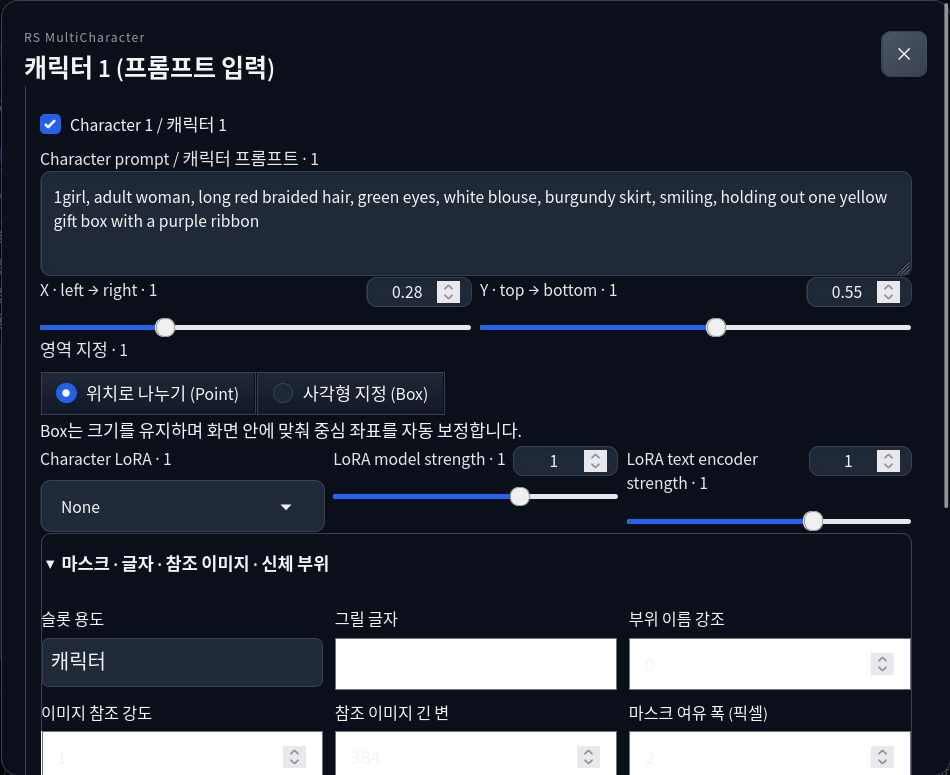
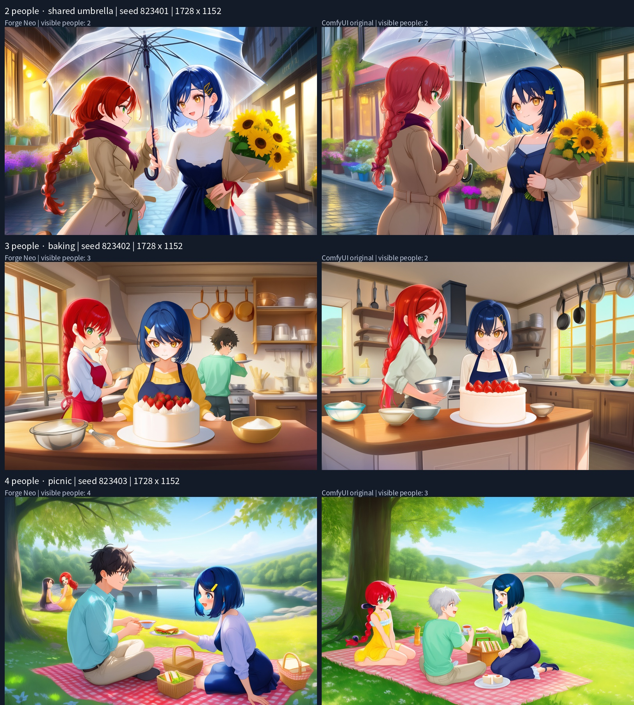

# Validation for 0.2.0a1

Recorded 2026-11-07. [Compact full-port report](validation/full-port-0.2.json) separates execution evidence from quality and untested combinations. Earlier a5 experiments follow below.

## New checks

- **39 unit tests**, Ruff, all three JavaScript syntax checks, and **95 source/assets** verification passed locally.
- **RTX 5060 Ti**, selected by GPU UUID. No new diffusion inference was assigned to the 4070. WD/PixAI taggers and detector scoring use CPU. Browser auto-launch is disabled in both the test profile and the default Forge config.
- Expanded native Anima runtime vs the actual original ComfyUI routing/LoRA implementation: **36 small-model cases, max error 0**. [Report](validation/parity-0.2-tiny.json).
- Captured **trained Anima 2B** state/input at **1728×1152**, BF16, two LoRAs: **Normal and Precision, max error 0** on the 5060. [Report](validation/parity-0.2-real.json). The previously saved live output from the 4070 differs from this 5060 replay (max 0.03125). That cross-GPU/kernel measurement is diagnostic; the same-device original-vs-port comparison remains strict. Independent complete sampling/VAE/PNG identity is not established.
- Small native forward calls and hook cleanup passed for **Anima, SD1.5, SDXL, Krea2, MOSS, FLUX1, FLUX2**. [Report](validation/native-families-0.2.json). These use small random weights, not trained checkpoints for those other families.
- Actual **Anima 2B** generation executed camera/interaction, explicit masks, body parts, text, progressive resolution, learned pose, all four Anima reference methods, YOLO/SAM detailer and multi-character tag matching. No claim of improved appearance or exhaustive combinations follows from successful execution.
- Folder detailer also passed after unloading the model, including lazy checkpoint loading, SAM segmentation, crop regeneration and output PNG/report. Existing output files were rejected without overwrite. [Folder/tagger record](validation/folder-tagger-0.2.json).
- Actual **SAM 3D Body** converted a single-person crop to an editable 3D scene. WD ViT v3 and PixAI v1.0 returned actual local scores; PixAI is slow on CPU. SEGM/SAM choices depend on separately installed weights.
- In Firefox: floating character editor, mask drawing/import/application, JSON/PNG import and restored mask margin. A **Generate button** run used 1728×1152, Euler a / SGM Uniform, 24 steps, CFG 4, seed 824201, with mask + camera + interaction + literal text + progressive enabled. The PNG restored all three configured slots and advanced settings; the remaining seven UI slots were disabled. Runtime recorded **24 calls and 24 restored calls**, through token grids 48×72 → 60×90 → 72×108.

The combined high-resolution test produced an **additional person, duplicated gift boxes and unreadable sign text**. This is retained as a failed scene-quality case. Runtime/metadata success does not imply that the requested scene was followed.

Optional dependencies are lazy, with dedicated requirement files. Trained-checkpoint tests for other families, all extended adapter formats, quantized variants, every feature combination and paid NAI generation were not performed. NAI interoperability here is a settings bridge.

---

# Earlier validation for 0.1.0a5

Recorded 2026-11-07. These are compact summaries of local experiments. Checkpoint weights, raw model captures and machine-specific paths are excluded.

## Environment and repeatable checks

- Forge Neo neo-2.31, commit 4f4284b02a5c814b81c328c64ed7e99a139f21ef.
- Python 3.12, PyTorch 2.14.0+cu130, Gradio 4.40.0; Linux / NVIDIA RTX 4070 Ti SUPER for checkpoint generation.
- Anima 2B anima-base-v1.0; character tests used anima_RSC and anima_MyMyArtStyleLoRA. Weights not bundled.
- Publication recheck: **29 unit tests passed**, Ruff and bundled-source verification passed, native CPU smoke passed with exact restoration after completion and simulated failure.
- [Native backend report](validation/native-smoke.json): real Forge classes with small random weights, not trained-checkpoint generation.

## Original ComfyUI calculation comparison

Corrections: RoPE frequency precision, AdaLN operation ordering, Point smoothing 0.04, Box/Point overlap priority, BF16 Normal overlap averaging. Defaults restored to 0.05 / 1.7 / 0.9 / 3 / 0.2.

| Comparison | Result |
| --- | --- |
| Real small-model classes: 2 dtypes × 3 layouts × 2 modes × 3 stages | 36 cases, maximum absolute error 0 |
| Captured Anima 2B first step, 1728×1152, BF16, two LoRAs | Normal and Precision, maximum absolute error 0 |
| Actual captured Forge Precision prediction vs replay | Maximum absolute error 0 |

[Small-model report](validation/parity-tiny.json) · [Anima first-call report](validation/parity-real.json).

These compare **identical encoded text, latent, sigma and weights** through the model/region/LoRA path. Independent prompt parsing, encoding, RNG, complete sampling and VAE equality are not established. Actual-checkpoint comparison covers a captured first call, not all steps/configurations.

## Actual WebUI experiments

These were completed locally during development, with the relevant paths retained in a5:

- Normal/Precision generation with two different LoRAs; 1728×1152 generation; img2img and Hires.fix (768×512 → 960×640).
- Floating editor persistence, character add/disable, Escape, output-ratio preview and edge-clamped Boxes.
- Actual Chrome 3D rendering, applying silhouettes and generating; pose import/library APIs and original editor assets are bundled.
- PNG Info restoration to both tabs; exported RS JSON matched PNG JSON including strengths, regions and schedule.
- Prompt-drop handler tested using a PNG File in a browser DataTransfer, followed by Forge restore, in both tabs. **Physical file-manager mouse drag was not independently verified.** Dropping alone fills infotext; restore applies settings.
- Extension OFF generation after injected failure matched the pre-test OFF result pixel-for-pixel.

These are recorded experiments, not all CI browser tests. Other operating systems, browsers, extension combinations and model families are outside this validation.

## Two-, three- and four-person comparison

Left: Forge. Right: ComfyUI. Each scene generated once per app with the same requested model/LoRAs, prompts, coordinates, schedule and seed. Same seed numbers do not establish identical initial noise.

All: 1728×1152, Euler ancestral / SGM uniform, 24 steps, CFG 4, Precision. Scene schedule: common 0.5, gain 1.0, separation 0.2.

| Request | Forge | ComfyUI |
| --- | --- | --- |
| 2, umbrella outside flower shop, seed 823401 | Two retained; bouquet holder also grabs umbrella | Two; similar action error |
| 3, strawberry cake, seed 823402 | Three; assigned baking roles largely absent | Two; male absent, roles also absent |
| 4, riverside picnic, seed 823403 | Four; identity/gender and interaction-pair errors | Three; missing person, merged silver hair/mint shirt |

One seed per scene cannot rank stability. Both apps lose identity, count or roles as complexity grows. Failures are retained intentionally. Hands, contact and shared objects remain limitations.
